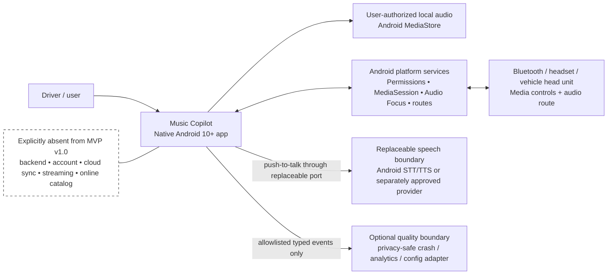
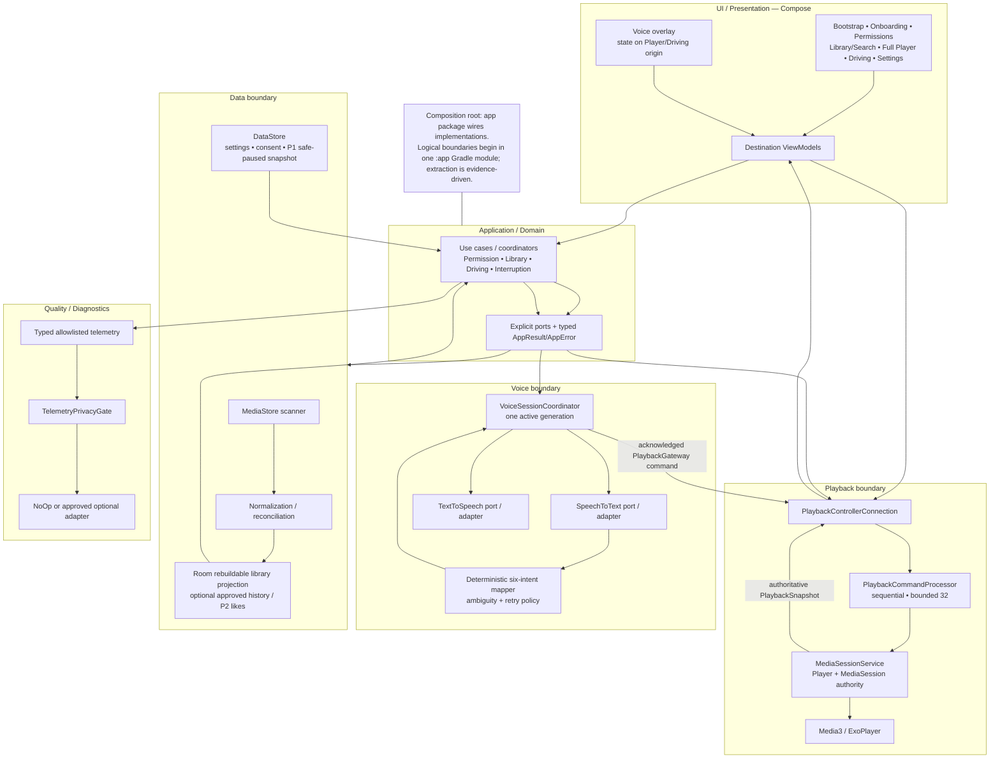
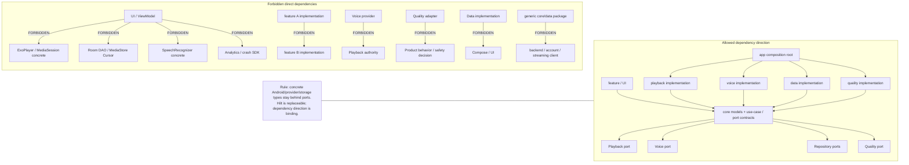
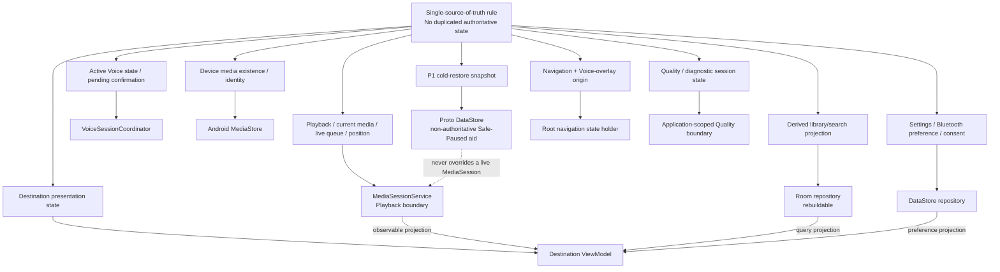
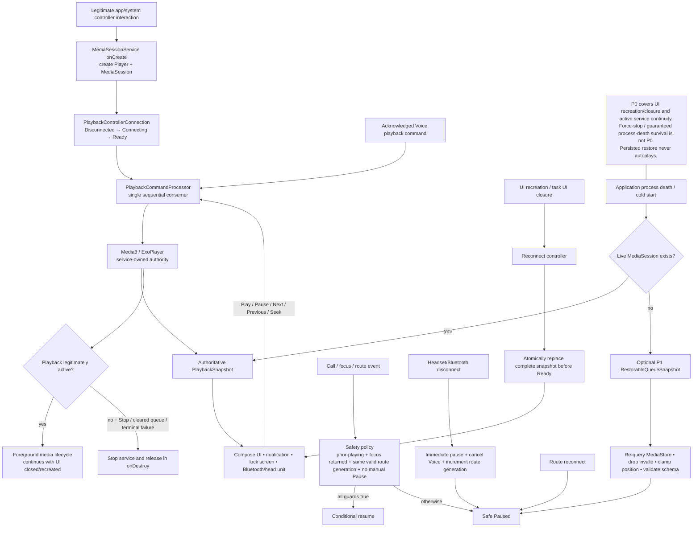
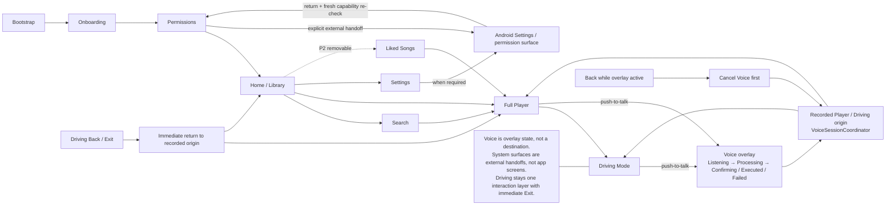
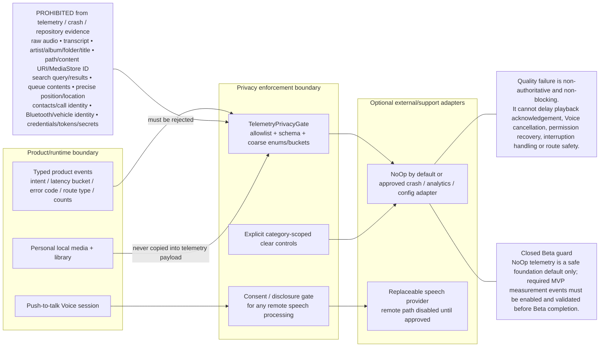

```mermaid
flowchart TB
    subgraph F1["F1 — Library scan and presentation"]
        F1A["MediaStore scan"] --> F1B["normalize + reconcile"] --> F1C["Room rebuildable projection"] --> F1D["Library/Search UI projection"]
    end

    subgraph F2["F2 — Track selection and playback authority"]
        F2A["Track selection"] --> F2B["PlaybackGateway / queue command"] --> F2C["MediaSessionService live queue"] --> F2D["ExoPlayer"] --> F2E["authoritative PlaybackSnapshot"]
    end

    subgraph F3["F3 — Manual playback command"]
        F3A["UI / system manual command"] --> F3B["PlaybackControllerConnection"] --> F3C["PlaybackCommandProcessor"] --> F3D["MediaSessionService"] --> F3E["synchronized UI + notification + lock screen + external controls"]
    end

    subgraph F4["F4 — Voice execution / confirmation"]
        F4A["Push-to-talk"] --> F4B["STT port"] --> F4C["deterministic mapper + candidate resolver"] --> F4D{"direct certainty?"}
        F4D -->|"yes"| F4E["serialized PlaybackGateway command"]
        F4D -->|"ambiguous"| F4F["one bounded confirmation"] --> F4E
        F4D -->|"not found / timeout"| F4G["one Retry then manual fallback"]
        F4E --> F4H["authoritative playback acknowledgement"] --> F4I["short TTS result"]
    end

    subgraph F5["F5 — Call / focus / route interruption"]
        F5A["Android call / focus / route event"] --> F5B["Interruption safety policy"] --> F5C{"resume guards all true?"}
        F5C -->|"yes"| F5D["conditional resume"] --> F5F["synchronize service + UI + system surfaces"]
        F5C -->|"no"| F5E["Safe Paused"] --> F5F
        F5G["route disconnect"] --> F5H["pause + cancel Voice + increment route generation"] --> F5E
    end

    subgraph F6["F6 — Privacy-safe telemetry"]
        F6A["typed allowlisted event"] --> F6B["TelemetryPrivacyGate"] --> F6C{"schema + prohibited-data check"}
        F6C -->|"pass"| F6D["NoOp or approved optional quality adapter"]
        F6C -->|"reject"| F6E["drop / typed local diagnostic only"]
    end

    subgraph F7["F7 — Permission revocation and truthful recovery"]
        F7A["permission / capability revoked"] --> F7B["fresh Android/provider truth re-check"] --> F7C["MediaStore index reconciliation"] --> F7D["remove / invalidate stale Room projection"] --> F7E["truthful Library UI: denied / empty / recoverable"] --> F7F["Retry or explicit Settings handoff"]
    end

    subgraph F8["F8 — Corrupt media item"]
        F8A["ExoPlayer reports corrupt / unplayable item"] --> F8B["typed MediaItem/Playback error"] --> F8C["controlled bounded skip"] --> F8D{"next valid queue item?"}
        F8D -->|"yes"| F8E["continue queue"]
        F8D -->|"no"| F8F["Safe Paused / queue end with recoverable UI"]
    end

    subgraph F9["F9 — P1 cold restoration"]
        F9A["versioned Proto DataStore snapshot"] --> F9B["schema validation"] --> F9C["MediaStore re-query"] --> F9D["drop invalid + clamp position"] --> F9E["prepare queue Paused only"]
    end

    RULE["All playback mutation converges on MediaSessionService authority.\nRoom is never live queue truth. Persisted restore never autoplays.\nVoice/telemetry never persist raw audio or transcripts."]
    RULE --- F2
```

# Software Architecture Baseline — MVP v1.0

- **Version:** MVP v1.0
- **Status:** **BASELINE REVIEWED THROUGH PHASE 10 / FINAL EXIT-MERGE PENDING**
- **Updated:** 30 August 2026
- **Tracking:** [Issue #16](https://github.com/latticeward-labs/music-copilot/issues/16)
- **Upstream gates:** [Issue #3](https://github.com/latticeward-labs/music-copilot/issues/3) **Done / Closed**; [Issue #15](https://github.com/latticeward-labs/music-copilot/issues/15) **Done / Closed**
- **Downstream gate:** Issue #4 remains blocked until final Issue #16 acceptance/merge/closeout
- **Source package:** user-attached English `MSM2(2).rar`, SHA-256 `0618cf20f1d7bd596ab744c1fa7b19bf257982f538e21670d11f15de0b029eb8`

This document is the single current implementation-facing Software Architecture baseline for Music Copilot MVP v1.0. Accepted ADRs remain the decision-history authority; this file integrates those decisions with approved User Flows, Wireframes, public contracts, runtime policies, diagrams, validation seams and the Phase 10 cross-role review. Dated phase/history files retain historical status only and do not override the current status stated here.

**No Persian/Farsi PRD or MVP is used as architecture authority.** The controlling product sources are the English PRD/MVP members in the attached source package as recorded in the [Source and Authority Register](architecture/SOURCE_AND_AUTHORITY_REGISTER.md).

## 1. Current repository state

| Item | Current state |
|---|---|
| Issue #3 — User Flows/state inventory | **Done / Closed — 23 August 2026** |
| Issue #15 — Low-fidelity Wireframes | **Done / Closed — 27 August 2026** |
| Issue #16 — Software Architecture | **In Progress — Phase 10 PASS; cross-role approvals recorded; final acceptance/merge/closeout pending** |
| Issue #4 — Android foundation | **Blocked by final Issue #16 exit gate** |
| ADR-0001..0008 | **Accepted** |
| Phase 10 open Blocker / Major | **0 / 0** |
| Phase 10 open Minor | **3 downstream / non-blocking; all owned and gated** |
| P2 Liked Songs | **Removable / non-blocking** |

## 2. Architecture evidence index

### Core matrices, contracts and registers

- [Source and Authority Register](architecture/SOURCE_AND_AUTHORITY_REGISTER.md)
- [Architecture Traceability Matrix](architecture/ARCHITECTURE_TRACEABILITY_MATRIX.md)
- [Decision and Technical Spike Register](architecture/DECISION_AND_SPIKE_REGISTER.md)
- [Phase 4 ADR Audit](architecture/ADR_PHASE4_AUDIT.md)
- [Phase 5 Architecture View Audit](architecture/PHASE5_ARCHITECTURE_VIEW_AUDIT.md)
- [Phase 6 Implementation Structure and Public Contracts](architecture/IMPLEMENTATION_STRUCTURE_AND_PUBLIC_CONTRACTS.md)
- [Phase 6 Implementation Readiness Audit](architecture/PHASE6_IMPLEMENTATION_READINESS_AUDIT.md)
- [Phase 7 Runtime Policies](architecture/RUNTIME_POLICIES.md)
- [Phase 7 Runtime Policy Audit](architecture/PHASE7_RUNTIME_POLICY_AUDIT.md)
- [Phase 8 Validation and Test Architecture](architecture/ISSUE_16_VALIDATION.md)
- [Phase 9 Repository Synchronization Audit](architecture/PHASE9_REPOSITORY_SYNC_AUDIT.md)
- [Phase 10 Cross-role Review](architecture/review/ISSUE_16_CROSS_ROLE_REVIEW_2026-08-30.md)
- [Phase 10 Findings Register](architecture/review/ISSUE_16_FINDINGS_REGISTER.json)
- [Phase 10 Reviewed Contract Corrections](architecture/review/ISSUE_16_CONTRACT_CORRECTIONS_2026-08-30.md)
- [ADR Register](adr/README.md)

### Architecture diagrams

1. [System Context](architecture/diagrams/01-system-context.mmd)
2. [Container / Component Architecture](architecture/diagrams/02-container-component-architecture.mmd)
3. [Allowed and Forbidden Dependency Direction](architecture/diagrams/03-dependency-direction.mmd)
4. [State Ownership](architecture/diagrams/04-state-ownership.mmd)
5. [Playback Ownership and Lifecycle](architecture/diagrams/05-playback-ownership-lifecycle.mmd)
6. [Navigation and Voice Overlay](architecture/diagrams/06-navigation-voice-overlay.mmd)
7. [Critical Data Flows](architecture/diagrams/07-critical-data-flows.mmd)
8. [Privacy and Telemetry Boundary](architecture/diagrams/08-privacy-telemetry-boundary.mmd)

The standalone `.mmd` sources must remain byte-equivalent to the eight inline Mermaid blocks below.

## 3. Binding baseline constraints

- Native Android 10+ with Kotlin and Jetpack Compose.
- Media3/ExoPlayer playback is service-owned and independent of Activity/ViewModel lifecycle.
- UI observes authoritative playback state and submits commands; it never owns Player, queue or live position truth.
- MediaStore is the authority for local device-media existence and identity.
- Room is a rebuildable derived library/search projection plus only explicitly approved app-owned records.
- DataStore owns settings/consent and the non-authoritative P1 Safe-Paused restoration snapshot.
- Voice is push-to-talk behind replaceable STT/TTS ports.
- Executable Voice behavior is restricted to exactly six deterministic MVP intents with bounded ambiguity, confirmation and retry behavior.
- Raw audio, transcript and prohibited personal media/identity data never enter telemetry.
- No product backend, account, cloud sync, streaming or online catalog is introduced.
- P0 UI recreation/closure continuity is distinct from P1 cold restoration; persisted restoration never autoplays.
- Android 10/12/14+, Pixel/Samsung/Xiaomi and 3+ real vehicle/head-unit models remain downstream QA/Field gates.
- Phase 10 cross-role review corrections are binding refinements and do not create a new owner, event bus, process, persistence authority or Gradle module.

## 4. Accepted ADR integration

- [ADR-0001](adr/0001-native-android-platform.md) — Native Android platform baseline.
- [ADR-0002](adr/0002-service-owned-media3-playback.md) — service-owned Media3 playback.
- [ADR-0003](adr/0003-local-first-data-boundaries.md) — MediaStore/Room/DataStore boundaries.
- [ADR-0004](adr/0004-replaceable-voice-provider.md) — replaceable Voice provider.
- [ADR-0005](adr/0005-deterministic-intent-mapping.md) — restricted deterministic intent mapping.
- [ADR-0006](adr/0006-no-backend-account-streaming.md) — no backend/account/streaming product service.
- [ADR-0007](adr/0007-same-process-playback-runtime-and-safe-paused-restore.md) — same-process service runtime, structured concurrency, serialized commands and Safe-Paused restoration.
- [ADR-0008](adr/0008-minimal-modular-monolith-and-dependency-enforcement.md) — one initial `:app` modular monolith with enforced dependency/state/data ownership and evidence-driven extraction.

ADR-0007 and ADR-0008 elaborate the earlier Accepted ADRs; neither silently supersedes them. Phase 10 created no new ADR and changed no Accepted ADR decision. A future material incompatible choice requires a new ADR explicitly stating `Supersedes ADR-xxxx`.

## 5. Boundary responsibilities

| Boundary | Owns | Must not own |
|---|---|---|
| UI / Presentation | destination presentation state, user intent, rendering, accessibility semantics, navigation requests | Player, live queue, MediaStore/Room concrete access, provider SDKs |
| Application / Domain | use cases, coordinators, typed ports/results/errors | Android concrete adapters or duplicated shared authority |
| Playback | `MediaSessionService`, Player, MediaSession, live queue/current item/position, command serialization | UI state or repository truth |
| Voice | STT/TTS ports, deterministic mapper, immutable candidate/confirmation state, one active session generation | Player authority, persistent transcript/audio |
| Data | MediaStore scan/re-query, normalization, Room projection, DataStore preferences/consent/P1 snapshot | live playback authority or UI state |
| Quality | typed allowlisted diagnostics, privacy gate, optional non-authoritative sink/config adapters | product/safety decisions, raw personal payloads |

## 6. State ownership

- Playback/current media/live queue/position → `MediaSessionService`.
- Active Voice state/pending confirmation → `VoiceSessionCoordinator`.
- Device media existence/identity → Android MediaStore.
- Derived library/search projection → Room repository.
- Settings/Bluetooth preference/consent → DataStore repository.
- Destination presentation state → destination ViewModel.
- Navigation and Voice-overlay origin → root navigation state holder.
- Quality/diagnostic session state → application-scoped Quality boundary.
- P1 restorable queue snapshot → Proto DataStore as a non-authoritative aid.

Duplicated authoritative state is forbidden.

### 6.1 Phase 10 Voice confirmation correction

The approved P0 confirmation UI requires an immutable current candidate set. The binding contract is:

```kotlin
data class VoiceConfirmationOption(
    val optionIndex: Int,
    val displayLabel: String,
)

data class Confirming(
    val sessionId: VoiceSessionId,
    val origin: VoiceOrigin,
    val token: VoiceCandidateToken,
    val options: List<VoiceConfirmationOption>,
) : VoiceSessionState
```

`options.size` is 1..2. Order is immutable for the token. The UI submits only the bound `token + optionIndex`; it does not query a repository side channel to reconstruct candidates. `displayLabel` is ephemeral presentation-only personal media text and is prohibited from telemetry, persistence, crash payloads and repository evidence. Neither/Cancel remain recovery actions rather than synthetic candidate entries.

This resolves **PH10-MAJ-001** without changing Voice ownership.

## 7. Runtime, lifecycle and concurrency policy

- Production playback uses a same-application-process `MediaSessionService`; no dedicated playback `android:process` is configured.
- Service lifecycle creates and owns Player/MediaSession. UI recreation or closure never constructs a replacement Player.
- One application-scoped `PlaybackControllerConnection` exposes `Disconnected`, `Connecting`, `Ready` and `RecoverableError` plus a complete observed `PlaybackSnapshot`.
- Complete snapshot replacement occurs before connection becomes `Ready`.
- Every UI/system/Voice playback mutation converges on one `PlaybackCommandProcessor` with a single sequential consumer and bounded capacity 32; overflow returns typed Busy and accepted commands are never silently dropped.
- `GlobalScope` is forbidden. UI uses `viewModelScope`; Playback uses a service-owned `SupervisorJob`; Voice owns one cancellable session child job; application/repository work that must outlive a screen uses an injected longer-lived scope.
- Main/player looper owns Player/MediaSession mutation; IO owns MediaStore/Room/DataStore/blocking adapters; Default owns normalization/matching.
- Voice owns one active generation token; cancellation/navigation/interruption invalidates prior work and stale callbacks are ignored.
- Playback acknowledgement precedes successful Voice/TTS completion state.

### 7.1 Phase 10 Playback runtime-error correction

`PlaybackSnapshot.lastError` is a typed `AppError?` projection, but only service-owned runtime families may appear there:

- `AppError.MediaItem` — missing/corrupt/unplayable current item;
- `AppError.Playback` — Player/command/runtime failure;
- `AppError.Interruption` — typed call/focus/route Safe-Paused outcome.

`AppError.Controller` remains connection/`PlaybackGateway.execute` level. Permission, Library, Storage, Privacy, Quality and Voice errors remain in their existing owners and must not be injected into Playback state. Only safe codes/recovery metadata may cross; raw exception messages, titles, paths, content URIs or provider payloads remain prohibited.

This resolves **PH10-MAJ-002** and prevents implementation from inventing a second UI error authority/event bus.

## 8. Persistence and restoration policy

- Live playback and queue are service-owned memory/MediaSession state.
- Room never becomes live queue truth.
- P1 restoration uses a versioned `RestorableQueueSnapshot` in Proto DataStore with stable media references, no title/artist/path payload.
- Snapshot writes are atomic and bounded/debounced by the approved runtime policy.
- Cold restore re-queries MediaStore, drops invalid items, validates schema and clamps position.
- A live MediaSession always wins over persisted restore.
- A valid cold restore prepares **Paused only**; it never autoplays.
- Invalid/corrupt/future-schema snapshot is ignored/discarded safely and falls back to Library/Safe Paused.

## 9. Navigation and Voice overlay

- Single-activity Compose `NavHost`.
- App-visible destinations: Bootstrap, Onboarding, Permissions recovery, Home/Library, Search, Full Player, Driving, Settings and optional P2 Liked Songs.
- Voice is overlay/state associated with Player or Driving origin; it is not an independent navigation branch.
- Back cancels Voice first when active.
- Driving Back/Exit returns immediately to the recorded origin.
- Android Settings and permission surfaces are external system handoffs followed by a fresh capability re-check; they are not invented app screens.

## 10. Error and recovery model

`AppError` categories are Permission, Library, MediaItem, Playback, Controller, Voice, Interruption, Storage, Privacy and Quality. UI receives typed recoverability and one approved `RecoveryAction`: `Retry`, `OpenSettings`, `Rebuild`, `Skip`, `ManualFallback`, `ManualResume` or `None`.

Key recovery rules:

- permission denial/revocation → truthful unavailable state, Retry/Not now or explicit Settings handoff, then fresh platform re-check;
- corrupt/unplayable item → typed service-authored error and bounded skip; if no valid item remains, Safe Paused/queue end;
- controller reconnect failure → recoverable controller state without fabricated playback truth;
- call/focus interruption → automatic resume only when prior Playing, focus returned, route generation unchanged/valid and no manual Pause;
- route disconnect → immediate pause, cancel Voice, invalidate route generation; reconnect alone never auto-resumes;
- Voice timeout → six seconds, one explicit Retry, second failure terminal to manual fallback;
- ambiguity → one bounded confirmation populated only by the current immutable one/two options; unsupported/not-found never guesses;
- privacy/quality failure → diagnostic event may be dropped; product/safety behavior continues.

## 11. Numeric interaction policy

- Seek Back: **10 seconds**.
- Previous: if position is **> 3 seconds**, restart current track; otherwise move to previous valid item.
- Voice listening timeout: **6 seconds**.
- Retry: **one**.
- Direct provider confidence default: **0.90**.
- Future validated tuning range: **0.80..0.98**.
- Artist clear similarity: **0.88**.
- Plausible similarity: **0.72**.
- Minimum top-two separation: **0.08**.

Missing/invalid confidence never direct-executes. Configuration cannot add intents, widen grammar or bypass confirmation.

## 12. Privacy and quality policy

`TelemetryPrivacyGate` accepts only typed allowlisted schemas with coarse enums/buckets/counts. It rejects raw audio, transcript, artist/album/folder/title, path/content URI/MediaStore ID, search query/results, queue/library contents, precise position/location, contacts/call identity, Bluetooth/vehicle identity and credentials/tokens/secrets.

Quality/analytics/configuration adapters are optional and non-authoritative. Their failure cannot delay playback acknowledgement, Voice cancellation, permission recovery, interruption handling or route safety. Any remote speech processing requires its own approved disclosure/consent/retention gate before activation.

Voice confirmation `displayLabel` is app-visible session data only and is explicitly prohibited from telemetry/persistence. Runtime error projection contains safe typed codes/recovery only.

## 13. Accessibility architecture

Accessibility remains a UI/Presentation responsibility over the same authoritative state; it may not duplicate Playback, Voice or navigation ownership.

Binding architecture/specification requirements inherited from the approved Wireframes and Definition of Done:

- interactive targets are at least 48dp where specified, with larger Driving controls where practical;
- TalkBack/semantic order follows the approved screen/state record;
- text must remain usable at 200% scaling/reflow without hiding the primary/recovery action;
- state is not communicated by color alone;
- Voice confirmation semantics expose current option labels and Neither/Cancel without creating a second candidate authority;
- asynchronous playback/route/error announcements must describe the current authoritative state rather than optimistic UI state.

Runtime Compose semantics, focus traversal and actual 200% reflow cannot be proven by static architecture. They remain **PH10-MIN-001**, owned by Issue #4 UI implementation + Issue #17 design handoff and gated by implementation accessibility QA/Definition of Done.

## 14. Module/package strategy

Production begins as one Gradle `:app` module with logical packages:

```text
com.latticeward.musiccopilot
├── app/        # Application, Activity, NavHost, DI composition root
├── core/       # shared models, AppResult/AppError, dispatcher contracts
├── feature/    # onboarding, library, search, player, driving, settings, liked(P2)
├── playback/   # api, service, controller, command processor, restoration
├── voice/      # api, provider adapters, mapper, session coordinator
├── data/       # api, MediaStore, Room, DataStore
└── quality/    # api, privacy gate, optional/NoOp adapters
```

Module extraction is allowed only when supported by ownership/reuse/build-isolation/dependency-enforcement evidence. Premature module explosion is not part of the MVP baseline.

## 15. Testing architecture

The normative test plan is [ISSUE_16_VALIDATION.md](architecture/ISSUE_16_VALIDATION.md). Required seams include:

- Unit: deterministic Mapper, Queue, Seek, Previous, interruption reducer, Voice state machine and Privacy filter.
- Integration: MediaSessionService/Player, MediaController/PlaybackGateway, Room, MediaStore, DataStore restoration, STT adapter and Quality fault isolation.
- System/UI: UI↔Service synchronization, Activity/controller recreation/reconnect, P1 cold restoration, corrupt-file recovery, permission denial/revocation, Call/Audio Focus/Route, Voice timeout/one-retry/ambiguity.
- Device/OEM: Android 10/12/14+, Pixel/Samsung/Xiaomi.
- Field/Beta: at least 3 real vehicle/head-unit models.

Phase 10 adds two review assertions to the existing seams:

- Voice ambiguity rendering/selection uses only current `Confirming.options`; stale token/options cannot execute.
- corrupt-media/interruption surfaces observe service-authored typed runtime errors from the authoritative snapshot; no second UI error authority/event bus is allowed.

Every P0-referenced Architecture path has at least one named Test seam and Recovery assertion. Documentation validation does not fabricate downstream physical execution.

# Architecture diagrams

## 16.1 System Context

Source: [`01-system-context.mmd`](architecture/diagrams/01-system-context.mmd)



## 16.2 Container / Component Architecture

Source: [`02-container-component-architecture.mmd`](architecture/diagrams/02-container-component-architecture.mmd)



## 16.3 Dependency Direction

Source: [`03-dependency-direction.mmd`](architecture/diagrams/03-dependency-direction.mmd)



## 16.4 State Ownership

Source: [`04-state-ownership.mmd`](architecture/diagrams/04-state-ownership.mmd)



## 16.5 Playback Ownership and Lifecycle

Source: [`05-playback-ownership-lifecycle.mmd`](architecture/diagrams/05-playback-ownership-lifecycle.mmd)



## 16.6 Navigation and Voice Overlay

Source: [`06-navigation-voice-overlay.mmd`](architecture/diagrams/06-navigation-voice-overlay.mmd)



## 16.7 Critical Data Flows

Source: [`07-critical-data-flows.mmd`](architecture/diagrams/07-critical-data-flows.mmd)



## 16.8 Privacy and Telemetry Boundary

Source: [`08-privacy-telemetry-boundary.mmd`](architecture/diagrams/08-privacy-telemetry-boundary.mmd)



## 17. Phase 9 repository synchronization gate

Phase 9 aligned the current repository-facing documents to one status and established machine checks for links, status, Mermaid parity, traceability and scope. Its [Repository Synchronization Audit](architecture/PHASE9_REPOSITORY_SYNC_AUDIT.md) remains historical evidence of that gate.

## 18. Phase 10 cross-role review and correction

The [Phase 10 Cross-role Review](architecture/review/ISSUE_16_CROSS_ROLE_REVIEW_2026-08-30.md) reviewed Product, Android architecture/feasibility, Design/UX/navigation, QA/testability, Accessibility architecture and Privacy/telemetry.

Reviewer identity is explicitly **OpenAI GPT-5.6 Sol — AI-assisted cross-role architecture review**. The GitHub actor `latticeward-labs` is not represented as multiple human reviewers. No independent human signature, Legal approval, production Android execution, physical OEM/vehicle result or Closed Beta outcome is fabricated.

Review result:

| Role | Phase 10 result |
|---|---|
| Product | **APPROVED — AI-assisted** |
| Android architecture/feasibility | **APPROVED after corrections** |
| Design/UX and navigation | **APPROVED after correction** |
| QA/testability | **APPROVED after corrections** |
| Accessibility architecture | **APPROVED at architecture/specification level** |
| Privacy/telemetry | **APPROVED at architecture level** |

Findings:

- Blocker: **0 found / 0 open**.
- Major: **2 found / 2 resolved / 0 open**.
- Minor: **3 open downstream/non-blocking**, all with explicit owner and downstream gate in the [Findings Register](architecture/review/ISSUE_16_FINDINGS_REGISTER.json).

The two resolved Majors are the Voice confirmation presentation-state gap and the Playback asynchronous runtime-error projection gap. Their exact binding declarations are recorded in the [Reviewed Contract Corrections](architecture/review/ISSUE_16_CONTRACT_CORRECTIONS_2026-08-30.md) and summarized in Sections 6.1 and 7.1 above.

Open Minors:

- `PH10-MIN-001` — runtime Compose semantics/TalkBack/reflow; owner Issue #4 UI + Issue #17 design; implementation accessibility QA gate.
- `PH10-MIN-002` — provider-specific remote STT disclosure/retention/Legal approval; owner Product + Privacy/Legal; remote path remains disabled until gate.
- `PH10-MIN-003` — physical Pixel/Samsung/Xiaomi and 3+ vehicle/head-unit execution; owner QA/Field-Beta; release/Field gate.

## 19. Approval state

Completed Issue #16 construction/review gates:

- Phase 4 — ADR decision control: **PASS**
- Phase 5 — architecture views: **PASS**
- Phase 6 — implementation contracts/package boundaries: **PASS**
- Phase 7 — runtime policy: **PASS**
- Phase 8 — test architecture/validation: **PASS**
- Phase 9 — repository/document synchronization: **PASS**
- Phase 10 — cross-role review/correction: **PASS**

Required Product + Android + Design + QA review approvals are now recorded **4/4** as AI-assisted evidence approvals. Accessibility and Privacy reviews also pass at architecture/specification level with explicit downstream non-claims.

Still required before Issue #16 can close and Issue #4 can unblock:

- final Acceptance-Criteria reconciliation;
- final link/traceability/Mermaid/review-register CI gate;
- PR #45 finalization/merge;
- Issue #16 closeout and explicit downstream unblock.

**Phase 10 PASS does not itself claim production Android implementation, physical OEM/vehicle execution, provider/Legal approval or Closed Beta completion.**