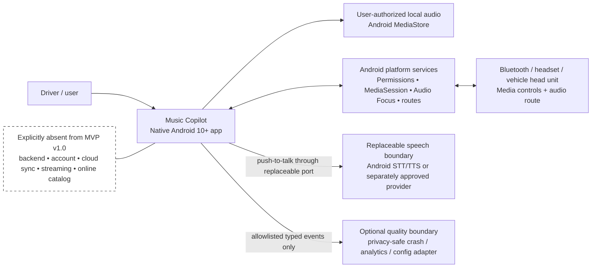
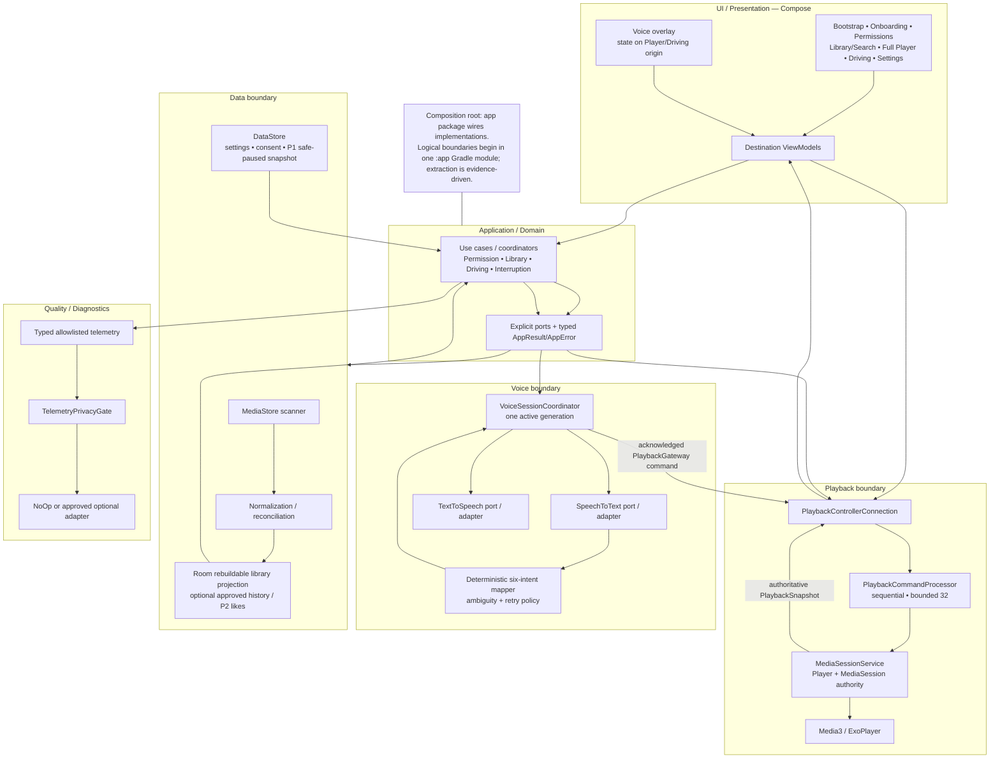
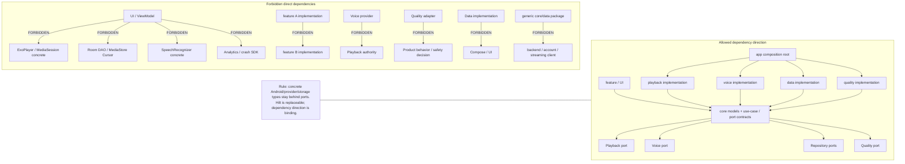
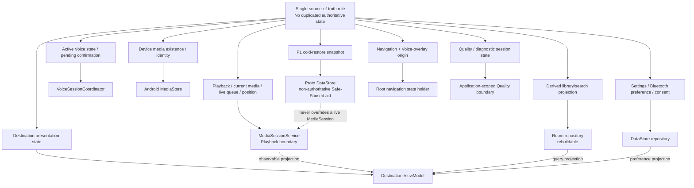
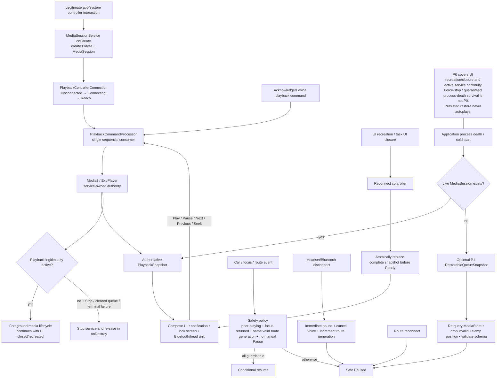
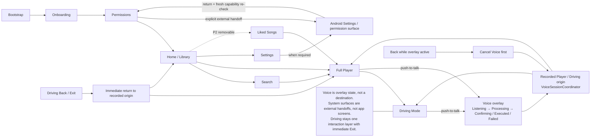
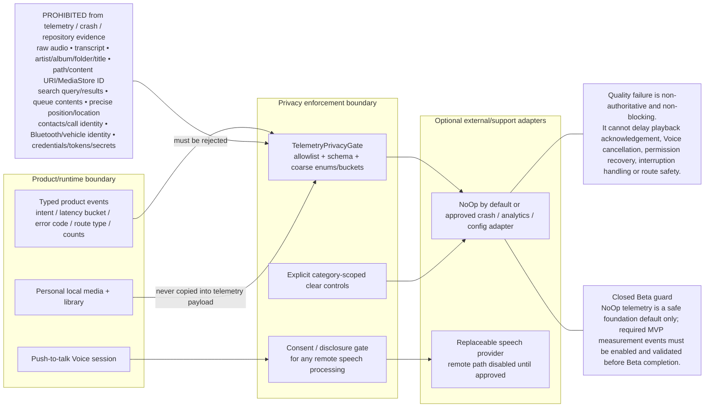

# Software Architecture Baseline — MVP v1.0

- **Status:** In progress — **Phase 7 Runtime Policies PASS / runtime-implementation-ready**, final Issue #16 approval still pending
- **Tracking:** [Issue #16](https://github.com/latticeward-labs/music-copilot/issues/16)
- **Depends on:** [Issue #2](https://github.com/latticeward-labs/music-copilot/issues/2), [Issue #3](https://github.com/latticeward-labs/music-copilot/issues/3) and [Issue #15](https://github.com/latticeward-labs/music-copilot/issues/15)
- **Attached product authority:** `Music_Copilot_PRD_v1_EN_Clarified.pdf` and `Music_Copilot_MVP_v1_EN.pdf` from the directly attached `MSM2(2).rar`
- **Current architecture authority:** accepted [ADRs](adr/README.md) plus Issue #16 approved evidence
- **Phase 4 evidence:** [ADR Decision Audit](architecture/ADR_PHASE4_AUDIT.md), [Decision/Spike Register](architecture/DECISION_AND_SPIKE_REGISTER.md), [Source/Authority Register](architecture/SOURCE_AND_AUTHORITY_REGISTER.md)
- **Phase 5 evidence:** [Architecture View Audit](architecture/PHASE5_ARCHITECTURE_VIEW_AUDIT.md) and independent Mermaid sources under [`docs/architecture/diagrams/`](architecture/diagrams/)
- **Phase 6 evidence:** [Implementation Structure and Public Contracts](architecture/IMPLEMENTATION_STRUCTURE_AND_PUBLIC_CONTRACTS.md) and [Implementation Readiness Audit](architecture/PHASE6_IMPLEMENTATION_READINESS_AUDIT.md)
- **Phase 7 evidence:** [Runtime Policies](architecture/RUNTIME_POLICIES.md) and [Runtime Policy Audit](architecture/PHASE7_RUNTIME_POLICY_AUDIT.md)

This file is the controlling pre-implementation architecture baseline. Text is authoritative over diagrams when interpreting a decision; diagrams must visualize, not invent or alter, the approved architecture. Missing details must not be invented inside feature implementation.

## 0. Direct attached-source verification

The Phase 4–7 baseline is bound to the user-attached English archive:

- `MSM2(2).rar` SHA-256: `0618cf20f1d7bd596ab744c1fa7b19bf257982f538e21670d11f15de0b029eb8`
- English PRD SHA-256: `486fbd5057e4abf570cd1a4865b6243ee5e31d26a48596414903916d6d81e9cf`
- English MVP SHA-256: `98e89a1c9d530f4eb878af94f4f480fc8d4669ce2ed5193ba71f201b032d47b0`
- English System Architecture SHA-256: `b056e3b8d3125e6660c2fd9431f4f883128673ed5ad1a7f3f5184dd179715bfb`
- English Code/Technical Blueprint SHA-256: `1d776396a88aebacbdb8b813fe8c6fe82418c951f301762ac594c55a7cd22cf3`
- the six attached English ADR PDFs match the identities recorded in the [Source/Authority Register](architecture/SOURCE_AND_AUTHORITY_REGISTER.md)

**Source exclusion:** no Persian/Farsi PRD or MVP is used as product authority, architecture evidence or Phase 4–7 validation input.

The attached English System Architecture and Technical Blueprint are engineering inputs, not final Issue #16 approval. They establish the high-level native Android, service-owned playback, local-first data, replaceable Voice and privacy boundaries while deliberately leaving several final ownership, lifecycle, navigation, concurrency and physical-module choices to Issue #16. Those final choices are recorded textually in ADR-0007/0008 and this baseline before they are illustrated below.

## 1. Baseline constraints established by the attached English sources and Accepted ADRs

- Native Android 10+ with Kotlin and Jetpack Compose.
- Lawful local audio only; no backend, account, cloud sync, online catalog or streaming.
- Media3 playback is independent of UI lifecycle and owned by a service.
- MediaStore is the authority for device media existence/identity.
- Room is a rebuildable derived library/search projection plus only explicitly approved app-owned records.
- DataStore owns settings/consent and the non-authoritative P1 Safe-Paused restoration snapshot.
- Push-to-talk Voice is behind a replaceable STT/TTS boundary.
- Executable Voice behavior is restricted to the deterministic six-intent contract with bounded confirmation/retry.
- Raw voice/transcripts and prohibited personal media metadata never enter telemetry.
- P0 active background/screen-off continuity is distinct from P1 FR-08 queue/position restoration.
- Android 10/12/14+, Pixel/Samsung/Xiaomi and at least three vehicle/head-unit models remain the downstream QA target matrix.

## 2. Phase 4 finalized consequential decisions

### 2.1 Runtime, lifecycle and concurrency — ADR-0007

See [ADR-0007](adr/0007-same-process-playback-runtime-and-safe-paused-restore.md).

- Playback uses a same-application-process `MediaSessionService`; no playback `android:process` is configured.
- Player and MediaSession are service-owned and never UI-owned.
- No boot/app-start autoplay is introduced.
- One application-scoped `PlaybackControllerConnection` exposes connection state and the observed authoritative `PlaybackSnapshot`.
- All UI/system/Voice playback mutations converge on one service-owned sequential `PlaybackCommandProcessor`, bounded to 32 pending commands with typed `Busy` overflow; accepted commands are never silently dropped.
- `GlobalScope` is forbidden. UI work uses `viewModelScope`; Playback uses a service-owned `SupervisorJob`; Voice owns one cancellable child session job; repository/application scopes own restartable work that must outlive screens.
- Main/player looper owns Player/MediaSession mutation; IO owns MediaStore/Room/DataStore/blocking adapters; Default owns normalization/matching.
- `VoiceSessionCoordinator` owns one active Voice generation and pending confirmation; invalidating events cancel prior work and stale callbacks are ignored.
- P0 does not promise force-stop or guaranteed process-death survival. P1 restore uses a versioned Proto DataStore snapshot, revalidates MediaStore and prepares **Paused only**, never autoplay.
- Conditional call/focus resume requires all four guards: prior Playing, focus returned, unchanged valid route generation and no manual Pause. Route disconnect immediately pauses, cancels Voice and invalidates route generation; reconnect remains Paused until explicit Resume.

### 2.2 Minimal modular monolith and dependency enforcement — ADR-0008

See [ADR-0008](adr/0008-minimal-modular-monolith-and-dependency-enforcement.md).

Production begins as one `:app` Gradle module with enforced logical packages:

```text
:app
└── com.latticeward.musiccopilot
    ├── app/                 # Application, Activity, NavHost, DI composition root
    ├── core/                # shared models, AppResult/AppError, dispatcher qualifiers
    ├── feature/             # onboarding, library, search, player, driving, settings, liked(P2)
    ├── playback/            # api, Media3 service, controller, command processor, restore
    ├── voice/               # api, provider adapter, mapper, session coordinator
    ├── data/                # api, MediaStore, Room, DataStore
    └── quality/             # api, privacy filter, NoOp/approved adapters

spikes/android-validation/   # isolated non-production evidence harness
```

`app/` is the composition root. UI/features depend on models, use cases and ports, not concrete Android/provider/storage implementations. Hilt remains a replaceable implementation choice; the binding decision is the dependency/ownership contract, not Hilt itself. Module extraction is evidence-driven and cannot introduce v1.1 scope.

## 3. Compatible finalized policies recorded textually

### Navigation and Voice overlay

- Single-activity Compose `NavHost`.
- Destinations: Bootstrap, Onboarding, Permission recovery, Home/Library, Search, Full Player, Driving, Settings and optional P2 Liked Songs.
- Voice is overlay/state owned by the initiating Player/Driving origin plus `VoiceSessionCoordinator`, never an independent navigation branch.
- Back cancels Voice first when active; Driving Back/Exit immediately returns to its recorded origin.
- Android Settings/permission surfaces are external handoffs followed by a fresh capability re-check, not invented app screens.

### Typed error and recovery model

Use sealed `AppError` categories: Permission, Library, MediaItem, Playback, Controller, Voice, Interruption, Storage, Privacy and Quality. Each exposes a stable non-sensitive code, recoverability and one `RecoveryAction`: `Retry`, `OpenSettings`, `Rebuild`, `Skip`, `ManualFallback`, `ManualResume` or `None`. Throwables remain inside infrastructure boundaries; UI receives typed state.

### Data/state authority

- playback/current media/live queue/position → `MediaSessionService` Playback boundary;
- active Voice state/pending confirmation → `VoiceSessionCoordinator`;
- media existence/identity → MediaStore;
- derived library/search projection → Room repository;
- settings/Bluetooth preference/consent → DataStore repository;
- destination presentation state → destination ViewModel;
- navigation/Voice-overlay origin → root navigation state holder;
- quality/diagnostic session state → application-scoped Quality boundary;
- P1 cold-restore snapshot → Proto DataStore as a non-authoritative Safe-Paused aid.

Duplicated authoritative state is forbidden.

### Numeric interaction and Voice policy

- seek-back: **10 seconds**;
- Voice listening timeout: **6 seconds**;
- retry: **one**;
- PREVIOUS: restart current track when position is **> 3 seconds**, otherwise move to previous item;
- direct-execution provider confidence `T_DIRECT`: **0.90**;
- future validated tuning range: **0.80..0.98**;
- artist clear similarity: **0.88**;
- plausible similarity: **0.72**;
- minimum top-two separation: **0.08**.

Missing/invalid confidence never direct-executes. Tuning cannot add intents, widen grammar or bypass confirmation.

### Provider/quality foundation defaults and Beta guard

Speech remains behind ADR-0004's replaceable port. Cloud speech is disabled by default. Foundation configuration may be Manual Only and quality adapters NoOp while provider/legal/retention evidence is missing, but those safe defaults do **not** satisfy final P0 Voice or Closed Beta measurement requirements. The required six-command Voice path and privacy-safe MVP measurement events must be enabled and validated before Beta completion.

## 4. Phase 5 Architecture Views

Every view below is embedded as Mermaid in this controlling document and stored byte-for-byte as an independent `.mmd` source. The [Phase 5 Architecture View Audit](architecture/PHASE5_ARCHITECTURE_VIEW_AUDIT.md) checks each view against ADR-0001..0008, the Phase 2 traceability paths, approved Wireframes and the attached English MSM2 source boundary.

### 4.1 System Context

Independent source: [`01-system-context.mmd`](architecture/diagrams/01-system-context.mmd)



**Contract represented:** the app is native/local-first; Android/system/vehicle surfaces are external actors and observers; speech/quality processors are replaceable/optional boundaries; backend/account/cloud sync/streaming/catalog remain absent.

### 4.2 Container / Component Architecture

Independent source: [`02-container-component-architecture.mmd`](architecture/diagrams/02-container-component-architecture.mmd)



**Contract represented:** UI, Application/Domain, Playback, Voice, Data and Quality responsibilities remain unambiguous; concrete Player/provider/storage adapters do not become UI/domain authority.

### 4.3 Allowed and Forbidden Dependency Direction

Independent source: [`03-dependency-direction.mmd`](architecture/diagrams/03-dependency-direction.mmd)



**Contract represented:** ADR-0008's package topology and dependency inversion are explicit, including forbidden concrete couplings and forbidden hidden product scope.

### 4.4 State Ownership

Independent source: [`04-state-ownership.mmd`](architecture/diagrams/04-state-ownership.mmd)



**Contract represented:** each shared state has one named authority; Room/DataStore/UI never duplicate the live playback authority.

### 4.5 Playback Ownership and Lifecycle

Independent source: [`05-playback-ownership-lifecycle.mmd`](architecture/diagrams/05-playback-ownership-lifecycle.mmd)



**Contract represented:** ADR-0002/0007 ownership, P0 UI-lifecycle independence, serialized commands, guarded interruption recovery and P1 Safe-Paused restoration.

### 4.6 Navigation and Voice Overlay

Independent source: [`06-navigation-voice-overlay.mmd`](architecture/diagrams/06-navigation-voice-overlay.mmd)



**Contract represented:** approved Wireframe screen families and recovery ownership; Voice states do not create a navigation branch, Android system UI is not invented as an app screen, and Driving keeps immediate Exit.

### 4.7 Critical Data Flows

Independent source: [`07-critical-data-flows.mmd`](architecture/diagrams/07-critical-data-flows.mmd)

```mermaid
flowchart TB
    subgraph F1["F1 — Library scan and presentation"]
        F1A["MediaStore scan"] --> F1B["normalize + reconcile"] --> F1C["Room rebuildable projection"] --> F1D["Library/Search UI projection"]
    end

    subgraph F2["F2 — Track selection and playback authority"]
        F2A["Track selection"] --> F2B["PlaybackGateway / queue command"] --> F2C["MediaSessionService live queue"] --> F2D["ExoPlayer"] --> F2E["authoritative PlaybackSnapshot"]
    end

    subgraph F3["F3 — Manual playback command"]
        F3A["UI / system manual command"] --> F3B["PlaybackControllerConnection"] --> F3C["PlaybackCommandProcessor"] --> F3D["MediaSessionService"] --> F3E["synchronized UI + notification + lock screen + external controls"]
    end

    subgraph F4["F4 — Voice execution / confirmation"]
        F4A["Push-to-talk"] --> F4B["STT port"] --> F4C["deterministic mapper + candidate resolver"] --> F4D{"direct certainty?"}
        F4D -->|"yes"| F4E["serialized PlaybackGateway command"]
        F4D -->|"ambiguous"| F4F["one bounded confirmation"] --> F4E
        F4D -->|"not found / timeout"| F4G["one Retry then manual fallback"]
        F4E --> F4H["authoritative playback acknowledgement"] --> F4I["short TTS result"]
    end

    subgraph F5["F5 — Call / focus / route interruption"]
        F5A["Android call / focus / route event"] --> F5B["Interruption safety policy"] --> F5C{"resume guards all true?"}
        F5C -->|"yes"| F5D["conditional resume"] --> F5F["synchronize service + UI + system surfaces"]
        F5C -->|"no"| F5E["Safe Paused"] --> F5F
        F5G["route disconnect"] --> F5H["pause + cancel Voice + increment route generation"] --> F5E
    end

    subgraph F6["F6 — Privacy-safe telemetry"]
        F6A["typed allowlisted event"] --> F6B["TelemetryPrivacyGate"] --> F6C{"schema + prohibited-data check"}
        F6C -->|"pass"| F6D["NoOp or approved optional quality adapter"]
        F6C -->|"reject"| F6E["drop / typed local diagnostic only"]
    end

    subgraph F7["F7 — Permission revocation and truthful recovery"]
        F7A["permission / capability revoked"] --> F7B["fresh Android/provider truth re-check"] --> F7C["MediaStore index reconciliation"] --> F7D["remove / invalidate stale Room projection"] --> F7E["truthful Library UI: denied / empty / recoverable"] --> F7F["Retry or explicit Settings handoff"]
    end

    subgraph F8["F8 — Corrupt media item"]
        F8A["ExoPlayer reports corrupt / unplayable item"] --> F8B["typed MediaItem/Playback error"] --> F8C["controlled bounded skip"] --> F8D{"next valid queue item?"}
        F8D -->|"yes"| F8E["continue queue"]
        F8D -->|"no"| F8F["Safe Paused / queue end with recoverable UI"]
    end

    subgraph F9["F9 — P1 cold restoration"]
        F9A["versioned Proto DataStore snapshot"] --> F9B["schema validation"] --> F9C["MediaStore re-query"] --> F9D["drop invalid + clamp position"] --> F9E["prepare queue Paused only"]
    end

    RULE["All playback mutation converges on MediaSessionService authority.\nRoom is never live queue truth. Persisted restore never autoplays.\nVoice/telemetry never persist raw audio or transcripts."]
    RULE --- F2
```



This view covers all required Phase 5 paths plus the pre-existing P1 cold-restoration path:

1. MediaStore scan → normalization/reconciliation → Room → Library/Search UI.
2. Track selection → queue command → MediaSessionService live queue → ExoPlayer → snapshot.
3. Manual command → controller → command processor → service → synchronized surfaces.
4. Voice → STT → deterministic mapper/candidates → direct or one confirmation → playback acknowledgement → TTS; failure gets one Retry then manual fallback.
5. Call/Focus/Route interruption → safety policy → conditional resume or Safe Paused → synchronized surfaces.
6. Typed telemetry → privacy gate → optional approved/NoOp quality adapter.
7. Permission revocation → fresh truth → index reconciliation → stale Room invalidation → truthful UI recovery.
8. Corrupt file → typed failure → bounded skip → queue continuation or Safe Paused queue end.
9. P1 cold restore → versioned snapshot → MediaStore validation → Paused-only preparation.

### 4.8 Privacy and Telemetry Boundary

Independent source: [`08-privacy-telemetry-boundary.mmd`](architecture/diagrams/08-privacy-telemetry-boundary.mmd)



**Contract represented:** only typed allowlisted coarse events may cross the privacy gate; prohibited Voice/media/identity content is rejected; quality remains non-authoritative; remote speech requires its own consent/disclosure gate; NoOp telemetry is not Beta completion.

## 5. View-to-text consistency rules

The diagrams above are constrained by these non-negotiable textual rules:

- UI is never playback or queue authority.
- Voice provider output never bypasses the deterministic mapper/confirmation policy and never becomes playback authority.
- MediaStore remains device-media truth; Room remains a derived/rebuildable projection.
- P1 persisted restore never overrides a live MediaSession and never autoplays.
- Android permission/settings, notification/lock-screen and interruption/route surfaces remain system-owned and are not invented as app destinations.
- Driving Mode remains one interaction layer with immediate Exit, no deep menus/typing/long result lists.
- Quality/telemetry failure never blocks product/safety behavior.
- No backend/account/cloud sync/streaming/online catalog is introduced.
- P2 Liked Songs remains removable and non-blocking for P0.

## 6. Concurrency, persistence, error and testing interpretation

### Concurrency

The normative [Phase 7 Runtime Policies](architecture/RUNTIME_POLICIES.md) operationalize ADR-0007 and the [Phase 6 public contracts](architecture/IMPLEMENTATION_STRUCTURE_AND_PUBLIC_CONTRACTS.md): injected scopes/dispatchers, no `GlobalScope`, one service command consumer, one active Voice generation and stale-callback suppression. Long-running work that must survive a screen is not owned by a UI scope.

### Persistence

- MediaStore → authoritative device media existence/identity.
- Room → rebuildable library/search projection; optional approved history/P2 Likes only.
- DataStore → settings/consent and P1 non-authoritative Safe-Paused snapshot.
- Live playback/queue → service-owned memory/MediaSession state, not Room/DataStore authority.

### Error/recovery

Permission revocation, empty/stale library, corrupt media, Voice timeout/ambiguity/not-found, controller failure, call/focus/route events and privacy/quality failures terminate in typed recovery rather than silent state mutation. Wireframe-visible recovery remains Manual Playback or service-owned Safe Paused where applicable.

### Testing seams

Phase 5 diagrams make the seams visible but do not claim downstream production/field testing has run. Required seams include fake MediaStore/Room/DataStore repositories, fake PlaybackController/Player, deterministic command processor, fake STT/TTS, deterministic mapper/candidate resolver, virtual timeout clock, interruption/focus/route gateways and schema/privacy-gate tests. Physical OEM/vehicle, provider/legal and Beta evidence remains downstream.

## 7. ADR control and supersession policy

The authoritative ADR register is [docs/adr/README.md](adr/README.md).

- ADR-0001..0006 remain Accepted and unchanged.
- ADR-0007 and ADR-0008 elaborate existing Accepted ADRs; neither silently supersedes them.
- A material future change to an Accepted ADR requires a new ADR explicitly stating `Supersedes ADR-xxxx`, with the prior file preserved.
- Replacing a source-declared replaceable implementation tool such as Hilt does not require supersession when approved contracts/ownership/dependency direction remain equivalent.
- No material decision may exist only in Mermaid/C4/sequence/state diagrams.

## 8. Approval checklist

- [x] Approved User Flows and Wireframes are traceable to architecture paths through the Phase 2 matrix and Phase 5 view audit.
- [x] System Context view exists in the main document and as independent `.mmd`.
- [x] Container/Component Architecture view exists in the main document and as independent `.mmd`.
- [x] Allowed/Forbidden Dependency Direction view exists in the main document and as independent `.mmd`.
- [x] State Ownership view exists in the main document and as independent `.mmd`.
- [x] Playback Ownership/Lifecycle view exists in the main document and as independent `.mmd`.
- [x] Navigation/Voice Overlay view exists in the main document and as independent `.mmd`.
- [x] Critical Data Flows cover the eight Phase 5 mandatory paths plus P1 cold restore and exist as independent `.mmd`.
- [x] Privacy/Telemetry Boundary view exists in the main document and as independent `.mmd`.
- [x] Attached `MSM2(2).rar` English source identity remains verified; Persian/Farsi authority is excluded.
- [x] ADR-0001..0008 and the Phase 4 decisions are represented without contradiction or silent supersession.
- [x] Approved Wireframe navigation, Voice-overlay, recovery and system-surface ownership are represented without contradiction.
- [x] Dependency direction, lifecycle/background/restoration and privacy/telemetry boundaries are diagrammed.
- [x] Phase 6 public contracts, package/dependency boundaries, DI ownership and module-extraction rules are complete.
- [x] Phase 7 lifecycle, concurrency, persistence, navigation, typed recovery and privacy runtime policies are complete.
- [ ] Product, Android, Design and QA approve the complete baseline.
- [ ] Final Issue #16 review/merge/exit gate passes.

## 9. Phase results

### Phase 4

**PASS / COMPLETE / SOURCE-CORRECTED.** Consequential choices are explicit in ADR-0007/0008, Accepted history is preserved and source-fixed versus Issue #16-finalized choices are distinguished.

### Phase 5

**PASS / COMPLETE / SOURCE-ALIGNED.** All eight required architecture view families exist both inline and as independent Mermaid `.mmd` sources. The Critical Data Flow view covers every required Phase 5 path plus the existing P1 cold-restoration contract. Cross-checks against ADR-0001..0008, the Phase 2 architecture paths and approved Wireframe behavior found **0 material contradictions** and **0 important decisions hidden only in diagrams**.

### Phase 6

**PASS / COMPLETE / IMPLEMENTATION-READY CONTRACT.** Six boundary responsibilities and all ten requested public-contract groups are explicit. Dependency direction, composition-root ownership, the one-`:app` package tree and anti-module-explosion criteria require **0 new boundary or ownership inventions** from the Android foundation.

### Phase 7

**PASS / COMPLETE / RUNTIME-IMPLEMENTATION-READY.** All **18/18** requested Runtime requirements are fixed across lifecycle, concurrency, persistence, navigation/Voice Overlay, typed recovery and privacy/telemetry. Analytics or Remote Config failure cannot stop Playback or replace service-owned authority. Exact unsupported controller timeout duration remains an implementation/test parameter; its typed failure/no-fabricated-success outcome is fixed.

This is **not** final Issue #16 approval and does not unblock Issue #4 by itself.