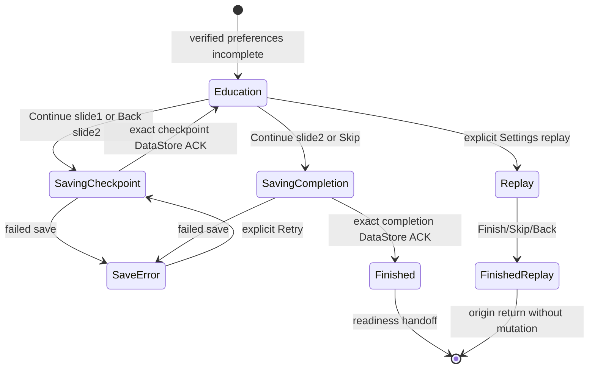
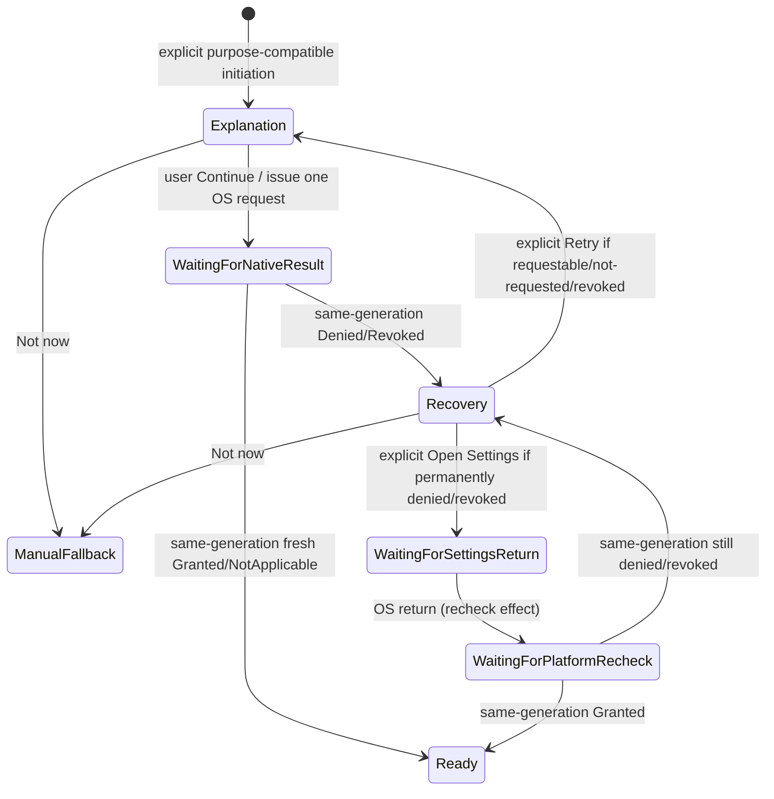

# Issue #5 — Phase 2: First-Use State Machine, Bootstrap Ownership and Permission Contracts

**Date:** 2026-10-16 · **Scope:** P02 typed application contracts, checkpoint persistence, pure reducers and JVM evidence. **NOT:** final UI, Android permission adapter, native dialog exercise, notification manifest change or physical-device acceptance.
**Authority:** English archive SHA-256 `0618cf20f1d7bd596ab744c1fa7b19bf257982f538e21670d11f15de0b029eb8`; controlling repository `docs/PRD.md`, `docs/MVP.md`, `docs/adr/README.md` (ADR-0001..0008 Accepted), `docs/SOFTWARE_ARCHITECTURE.md`, `docs/architecture/IMPLEMENTATION_STRUCTURE_AND_PUBLIC_CONTRACTS.md` and reviewed architecture corrections. Derived/approved UF-01/02/03 and GS-01, WF-01..04, Hi-Fi/Compose handoff and Recovery Terminal Matrix control navigation/behavior. Proposed source System Architecture/Code PDFs are not final implementation authority.

## 1. Implemented ownership and exact files

| Responsibility | Owner | P02 evidence |
|---|---|---|
| Startup routing, no assumption of readiness | Core application/bootstrap pure `BootstrapRoutePolicy` | `app/src/main/java/com/latticeward/musiccopilot/core/application/bootstrap/BootstrapRoutePolicy.kt` |
| First-use transitions and ACK-gated writes | Core application/bootstrap `FirstUseMachine` | `app/src/main/java/com/latticeward/musiccopilot/core/application/bootstrap/FirstUseMachine.kt` |
| Persisted two-page progress and final completion | Public `PreferencesRepository` / `DataStorePreferencesRepository` | `data/api/PreferencesRepository.kt`, `data/datastore/PreferencesDataStore.kt`; no permission-grant persistence |
| OS grant, denial and recovery *projection* | Core application/permission `PermissionPlatformPolicy` and `PermissionMachine` | `core/application/permission/PermissionMachine.kt` |
| Actual platform permission and OS Settings native handoff | Android OS, future adapter P04–P08 | **NOT IMPLEMENTED P02**; no Compose mock/screens/dialog invocation |
| Library/media truth and playback service | MediaStore + derived Room; Media3 Service | P02 does not change scanner, live queue, playback or voice provider |

**No root navigation mutation:** `MainActivity` and `AppNavHost` are unchanged; only Bootstrap remains registered until approved UI/permission integration phases. This prevents prematurely claiming AC-01..13.

## 2. First-use state chart (UF-01 / WF-02 / S-02 / CA-01)

First-use checkpoint starts at `Value`, then `SafetyAndVoice` (approved **two slides**, not two extra screens). `AppPreferences.onboardingCheckpoint` persists only the pending page in existing local Preferences DataStore. Saving is a distinct state; neither slide navigation nor `onboardingComplete` may claim success before exact `operationId` ACK. Wrong/out-of-date ACKs, duplicate taps and stale failures are ignored. A persisted failed write produces Retry without manufacturing success. Replay starts at Value and has no DataStore writes, scan, microphone request, MediaSession mutation, grant mutation or playback restart. `Continue`/`Skip` only enqueue checkpoint or completion effects; **P03 must execute actual writes through PreferencesRepository**. Progress updates survive repository recreation in a JVM-backed DataStore test. No exact user-media content or speech is persisted by this addition.

## 3. Bootstrap route safety (UF-01..03 / WF-01 / GS-01)

`BootstrapRoutePolicy.project(BootstrapEvidence)` separates preparation, migration failure, incomplete education, current OS permission/recovery, and Home/Library. Its inputs are fresh/verified booleans and library snapshots; it is a **pure routing proposal, not root navigation**. If preferences have not loaded or migrations are not verified, state is `Preparing`; a typed startup failure is `RetryStartup`; incomplete onboarding routes `Onboarding`; permission `Unknown` never equals Granted, and even `LibraryIndexStatus.Ready` cannot force access. Denied returns PermissionRecovery, except after an **explicit** Not now manual fallback when Home/Library must remain reachable. `HomeLibrary` means route only, never a fabricated playable track/Ready index. Existing MediaSessionService remains playback owner.

## 4. Permission source of truth and API matrix (UF-02 / S-03 / CA-02 / SYS-01..04)

| Capability | API 29–32 | API 33+ | When eligible |
|---|---|---|---|
| Local audio media | Android `READ_EXTERNAL_STORAGE` (manifest maxSdk 32) | `READ_MEDIA_AUDIO` | After explanation and consented first scan or explicit recovery |
| Microphone | `RECORD_AUDIO` | `RECORD_AUDIO` | Explicit Mic tap or selected Practice only; NEVER app/Driving entry |
| Notifications | Not applicable runtime `POST_NOTIFICATIONS` grant | `POST_NOTIFICATIONS` | Only after **acknowledged real** playback/background-controls value. Actual manifest declaration and adapter are deferred to P08. |

Permission `Unknown`, `NotRequested`, `Granted`, `DeniedRequestable`, `PermanentlyDenied`, `Revoked`, `NotApplicable` are **projections** of a fresh native observation plus minimal request context. DataStore never owns a Grant. `requestedBefore`/`previouslyGranted` are classification hints, not persisted grant authority. When `shouldShowRequestPermissionRationale=false`, Android does not universally prove a permanent denial without request history; the P04 adapter must implement request tracking and a conservative Settings-only recovery outcome and test OEM variance. Android 13+ `POST_NOTIFICATIONS` denial must never be treated as playback stopped; lower API prompts are not triggered. Manifest currently does not declare `POST_NOTIFICATIONS`: P02 documents the gap but does NOT claim AC-03 implemented.

## 5. Permission finite state machine

Entry checks capability/purpose pairing. `Continue` only works in Explanation. The native OS request is a typed **effect** for P04's Android adapter, never called implicitly by this reducer. Only exact-generation `NativeResult`/`Rechecked` transitions are accepted: no optimistic grant, no duplicate permission request, no stale callback execution. Android Settings is opened only from explicit recovery; `onResume` must generate a **fresh OS recheck** (not infer Granted) to resolve Granted/DeniedRequestable/PermanentlyDenied and possible Revoked. Denial/cancel uses safe manual fallback, no coercive loop or spontaneous Settings navigation. Revoking media emits `ReconcileRevokedMedia` and `PreserveManualControls`; microphone revocation emits Voice-generation cancellation but no playback command; notifications preserve manual controls. The P04/P06 adapters must make these effects real and idempotent.

## 6. STT/provider/consent and data safety

Microphone Grant, provider available, policy for any network processor and explicit documented remote consent are separate gates. This reducer neither enables cloud STT nor persists a grant, transcript, audio recording, song title, path or identifier. `CloudSpeechConsent` continues in its independent existing DataStore port; remote STT remains disabled until provider-specific legal/privacy approval, destination, purpose and retention/deletion terms (PH10-MIN-002). Failure or decline returns to reachable manual controls. No second playback authority, new account, streaming or analytics event is created.

## 7. Tests, nonclaims, next owners

- `Issue5Phase2StateMachineTest`: **18 JVM cases** for stable progress/ACK, retry/replay, bootstrap truth, API permission mapping, denial, Settings return, stale result, revocation, JIT and notification version distinctions.
- `Issue5Phase2CheckpointPersistenceTest`: **1 JVM case** for backed DataStore progress across repository recreation and completion ACK.
- P02 GitHub Actions must run architecture negative guards, privacy guard, P01 contract validator, real JVM unit tests, Android lint, Kotlin analysis, Spotless and Debug APK at the exact commit. A success is P02 contract/JVM/build proof, **NOT** a real dialog/API/device end-to-end test.
- Ownership of P03: Compose first-use UI, 2 slides, actual effects/persist hooks. P04: OS capability/denial classification adapter. P05–P06: rationale/native request/Settings recheck wiring. P07 JIT Mic. P08 conditional notifications and manifest; P09 cloud privacy; P10 GS-01 scan; P11–13 lifecycle/instrumentation/physical and accessibility. None is marked PASS from this phase.
- ACs remain **0/13 runtime accepted**. External review, any P14 target-branch deviation approval, physical device proof and actual GitHub merge remain outstanding. Status of Project V2 is unverified.

## P02 exit ledger

| Gate | Result |
|---|---|
| Repository + archive provenance and no boundary divergence | Verified source hierarchy and GitHub branch |
| Pure typed machines with no OS/UI/Player imports | Implemented; architecture guard must pass CI |
| Onboarding checkpoint persistent without grant truth | Implemented via DataStore port; JVM test must pass |
| Denial/revocation/Settings/no auto-loop/duplicate guards | Implemented pure reducer; JVM tests must pass |
| Exact-head Android CI + source readback | PENDING actual Actions result at author time |

**P02 decision:** Do not label PASS until required Actions run is successful and branch + Issue #5 invariants are rechecked. No early merge.
