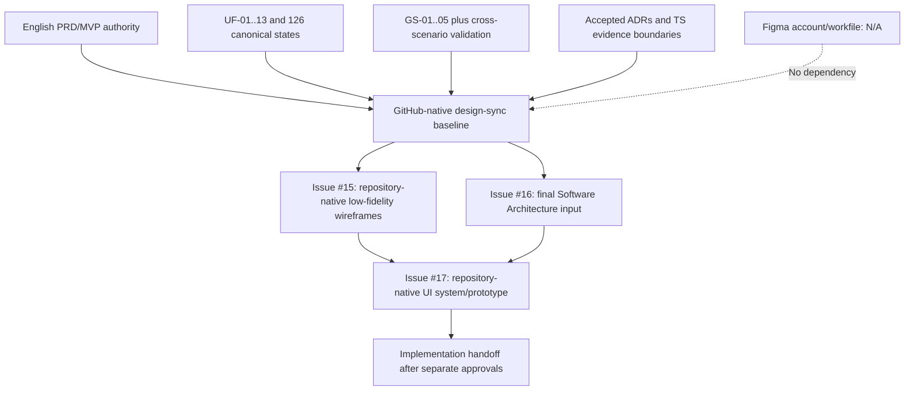

# GitHub-native Design Synchronization - Figma N/A

**Product:** Music Copilot MVP v1.0  
**Decision date:** 23 August 2026  
**Validated baseline:** `562214c70d8ab13d5ef6a145d0bfabed31335411`  
**Synchronization scope:** User Flows, State Inventory, Golden Scenarios and downstream design inputs  
**Figma disposition:** **N/A / NOT REQUIRED - no account, workfile, page, node or external Figma evidence**  
**Canonical workspace:** GitHub repository `latticeward-labs/music-copilot`  
**Decision:** **PASS / COMPLETE / SOURCE-ALIGNED for the no-Figma synchronization gate**  
**Canonical diagram:** [GITHUB_NATIVE_DESIGN_SYNC_2026-08-23.mmd](GITHUB_NATIVE_DESIGN_SYNC_2026-08-23.mmd)

## Purpose and substitution rule

The original instruction to synchronize User Flows, State Inventory and Golden Scenarios “with Figma” is satisfied as a GitHub-native synchronization gate because the project owner explicitly does not want a Figma account. GitHub Markdown, paired Mermaid sources, stable IDs, cross-links and review records replace the external design workfile for this gate.

This disposition is truthful: it records Figma as N/A rather than claiming that a nonexistent Figma file was created or synchronized. It changes the delivery medium, not product scope, state behavior or approval rigor.

## Authority and precedence

1. Official English `Music_Copilot_PRD_v1_EN_Clarified.pdf` and `Music_Copilot_MVP_v1_EN.pdf`, represented by [`docs/PRD.md`](../../PRD.md) and [`docs/MVP.md`](../../MVP.md).
2. Current GitHub `main` User Flow, State Inventory, Accepted ADR and Technical Spike records.
3. [Phase 1 complete Traceability Matrix](../PHASE_1_TRACEABILITY_MATRIX.md) and [sign-off](../PHASE_1_SIGNOFF_2026-08-23.md).
4. [Stage 2 Golden Scenario index](../golden-scenarios/README.md), [Traceability Matrix](../golden-scenarios/STAGE_2_TRACEABILITY_MATRIX.md), [Cross-scenario Validation](../golden-scenarios/CROSS_SCENARIO_VALIDATION_2026-08-23.md) and [sign-off](../golden-scenarios/STAGE_2_SIGNOFF_2026-08-23.md).

Persian/Farsi PRD/MVP attachments are translations and are excluded as product authorities.

## Synchronized artifact inventory

| Artifact family | Controlled coverage | Count / boundary | Synchronization result |
|---|---|---:|---|
| User Flows | UF-01 through UF-13 | 13/13 | PASS |
| Cluster A state inventory | `S-01..04`, `CA-01..02`, `SYS-01..05` | 11 | PASS |
| Cluster B state inventory | `CB-01..33` | 33 | PASS |
| Cluster C state inventory | `CC-01..18` | 18 | PASS |
| Cluster D state inventory | `CD-01..24` | 24 | PASS |
| Cluster E state inventory | `CE-01..26` | 26 | PASS |
| UF-13 state inventory | `UL-01..14` | 14 | PASS |
| Canonical states total | All namespaces above | 126 | PASS |
| Required Golden Scenarios | GS-01 through GS-05 | 5 Markdown + 5 Mermaid | PASS |
| Connected Golden validation | Cross-scenario Markdown + Mermaid | 1 pair; 8 handoffs | PASS |

## Ten-screen design-input crosswalk

| MVP screen/surface | User Flow owner | Canonical state input | Golden Scenario input | Sync result |
|---|---|---|---|---|
| Splash | UF-01 | `S-01` Loading/Migration Error | GS-01 | PASS |
| Onboarding | UF-01 | `S-02`, `CA-01/02` | GS-01 | PASS |
| Permissions | UF-02 | `S-03`, `SYS-01..05` | GS-01; GS-02 recovery | PASS |
| Home / Library | UF-03/04 | `S-04`, `CB-01..08` | GS-01 -> GS-02 | PASS |
| Search | UF-04 | `CB-09..13` | GS-02 | PASS |
| Full Player | UF-05/06 | `CB-14..33` | GS-02/03/05 | PASS |
| Driving Mode | UF-07 | `CC-01..18` | GS-04; GS-05 interruption | PASS |
| Voice Overlay / Voice State | UF-08/09/10 | `CD-01..24` | GS-04 primary/recovery | PASS |
| Liked Songs | UF-13 | `UL-01..14` | Optional P2 extension; not required by GS-01..05 | PASS / non-blocking |
| Settings | UF-12 | `CE-15..26` | GS-04/05 outside-driving recovery | PASS |

## System-only and cross-surface synchronization

The following do not require invented app screens. They must appear as annotations or system-only transitions in repository-native Wireframes:

- Android permission dialogs and explicit Settings handoff/recheck;
- Media notification, lock-screen controls and compatible headset/Bluetooth/vehicle media keys;
- background/UI-absent/controller reconnect and P1 Paused Restore boundaries;
- call, Audio Focus, wired/Bluetooth route loss/reconnect and Safe Paused behavior;
- cloud speech disclosure/consent outside active Driving Mode;
- analytics-unavailable behavior, which remains invisible and non-blocking.

## Golden Scenario synchronization

| Scenario | Entry/success design anchor | Required recovery anchors | Result |
|---|---|---|---|
| GS-01 | `S-01` -> `S-04 Ready` / `CB-01` | denial, Settings, scan failure, Empty, optional Voice decline | PASS |
| GS-02 | `CB-01` -> acknowledged `CB-15 Playing` | No Result, query error, stale selection, start rejection, corrupt item | PASS |
| GS-03 | `CB-15` -> background/system controls -> complete reconnect | notification denial, unavailable surface, lifecycle loss, Paused Restore | PASS |
| GS-04 | `CC-01/02` -> `CD-07` -> refreshed `CC-05` | ambiguity, not-found, one Retry, Manual Only, interruption | PASS |
| GS-05 | `CE-01` -> conditional Resume or Safe Paused | failed guard, permanent loss, disconnect, corrupt queue end | PASS |

[Cross-scenario Validation](../golden-scenarios/CROSS_SCENARIO_VALIDATION_2026-08-23.md) confirms 5/5 scenario parity, 8/8 connected handoffs, 6/6 recovery families, 6/6 source-of-truth contracts and zero broken relative targets in its recorded audit.

## Shared design annotations and source of truth

Every future repository-native frame/specification must annotate:

- user goal, priority and primary action;
- entry, exit, Back and cross-feature handoffs;
- owning UF/GS/state IDs;
- visible vs system-only behavior;
- Android permission state, MediaStore, derived index, Playback Service/MediaSession, Voice coordinator/provider and platform focus/route ownership;
- loading, Empty, error, denial, interruption, retry and terminal-safe recovery;
- P0/P1/P2 and removable-branch status;
- TalkBack order, scalable text, contrast, non-color-only state and 48dp minimum targets;
- allowed analytics event/buckets and prohibited personal/Voice payloads.

## GitHub-native delivery locations

| Gate | Canonical repository location | Current status |
|---|---|---|
| User Flows / states | `docs/user-flows/` and `docs/user-flows/mermaid/` | COMPLETE |
| Golden Scenarios | `docs/user-flows/golden-scenarios/` | COMPLETE |
| Design synchronization | `docs/user-flows/design-sync/` | COMPLETE |
| Low-fidelity Wireframes | `docs/wireframes/` plus `docs/WIREFRAMES.md` | READY for Issue #15; frames not yet approved |
| Software Architecture | `docs/SOFTWARE_ARCHITECTURE.md` and Issue #16 | Separate pending gate |
| UI system / prototype | future `docs/design-system/` and `docs/prototype/` artifacts under Issue #17 | Separate pending gate |

No external design service is required. If a design service is introduced later, GitHub remains the canonical behavioral contract and structural changes must return to the repository review gates.

## Synchronization validation

| Check | Result |
|---|---|
| UF-01 through UF-13 present and approved | 13/13 PASS |
| Canonical State Inventory namespaces complete | 126 states PASS |
| GS-01 through GS-05 Markdown/Mermaid parity | 5/5 PASS |
| Cross-scenario Markdown/Mermaid parity | PASS |
| Ten MVP screens mapped to UF/state/GS inputs | 10/10 PASS |
| System-only transitions identified without invented screens | PASS |
| Permission/consent, playback, provider and route authorities conflict-free | PASS |
| P0/P1/P2 separation and UF-13 removability preserved | PASS |
| Repository relative-link audit | PASS — 9 control documents, 223 link occurrences, 100 unique relative targets (including 5 repository-directory targets), 0 broken |
| Figma account/file/page/node dependency | N/A / none |
| Unsupported product/runtime/physical claim audit | PASS |

## Change control

1. Behavioral changes start in the owning UF/State/GS record and are propagated to the design-sync baseline and downstream artifacts in the same reviewed change.
2. Structural UX changes return to Issue #15; consequential architecture changes require a new/superseding ADR and Issue #16 review.
3. Paired Markdown/Mermaid content must retain logical parity.
4. GitHub links and stable IDs replace Figma page/node links for traceability.
5. Historical checkpoint wording is not rewritten unless it incorrectly claims current authority; current indexes and this disposition control the active gate.

## Canonical synchronization flow

## Final decision and non-claims

**PASS / COMPLETE / SOURCE-ALIGNED.** User Flows, the complete State Inventory and Golden Scenarios are synchronized into a single GitHub-native design baseline. Figma is formally N/A / Not Required, and Issue #15 may consume this baseline without an external account.

This approval does not create or approve low/high-fidelity screens, final visual styling, clickable prototype, final Software Architecture, implementation, provider/legal enablement, physical device/vehicle evidence, Release Candidate or Closed Beta results.
