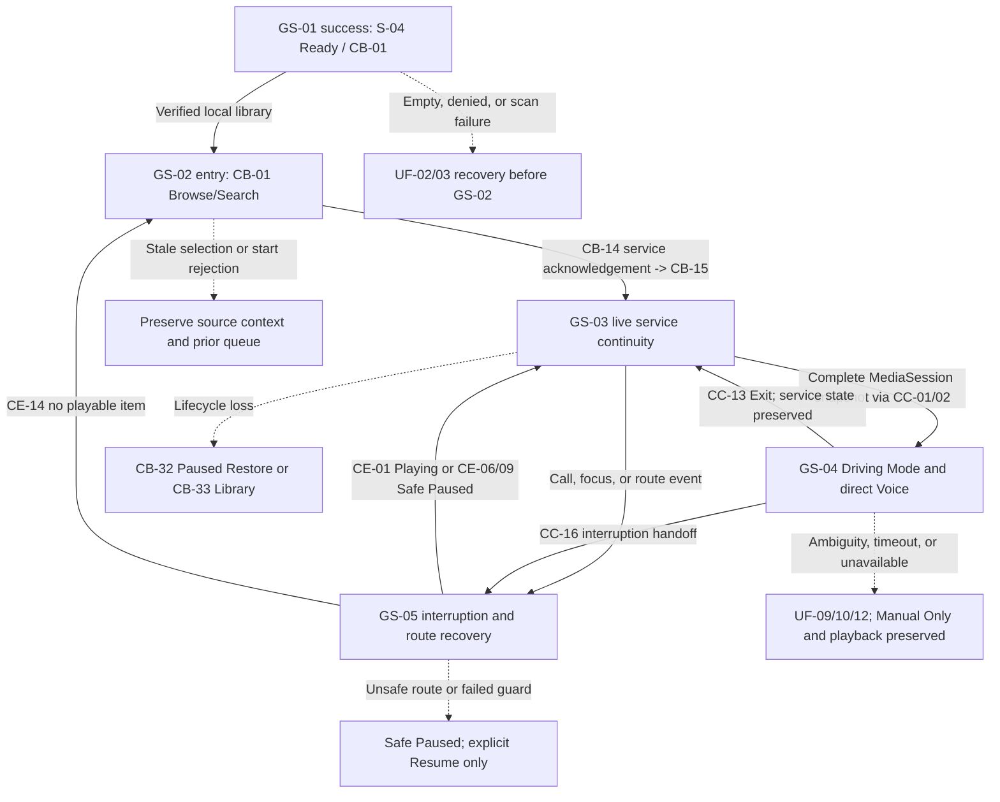

# Stage 2 - Cross-scenario Validation

**Product:** Music Copilot MVP v1.0  
**Validation date:** 23 August 2026  
**Validated baseline:** `5228668c6e5347e8e586564bb431b3d9404ca367`  
**Scope:** GS-01 through GS-05 Markdown/Mermaid parity, handoffs, recovery, state authority, traceability and scope  
**Canonical diagram:** [CROSS_SCENARIO_VALIDATION_2026-08-23.mmd](CROSS_SCENARIO_VALIDATION_2026-08-23.mmd)  
**Decision:** **PASS / COMPLETE / SOURCE-ALIGNED at static scenario-contract level**

## Authority and validation boundary

The official English PRD/MVP and current GitHub `main` User Flow, State Inventory, Accepted ADR and Technical Spike records are authoritative. Persian/Farsi translations are excluded as product authorities.

This is a static connected-contract validation. It proves document parity, traceability and state/recovery compatibility. It does not claim production implementation, device/OEM/provider/legal execution, physical vehicle/head-unit testing, Release Candidate, Closed Beta or KPI evidence.

## Artifact-pair validation

| Scenario | Markdown | Raw Mermaid | Embedded/raw logical parity | Required record fields | Result |
|---|---|---|---|---|---|
| [GS-01](GS-01_FIRST_LAUNCH_TO_READY_LIBRARY.md) | Present | Present | PASS | Goal, scope, entry, mapping, success, recovery, data, ADR/TS, review | PASS |
| [GS-02](GS-02_FIND_MUSIC_AND_START_PLAYBACK.md) | Present | Present | PASS | Goal, scope, entry, mapping, success, recovery, data, ADR/TS, review | PASS |
| [GS-03](GS-03_CONTINUE_PLAYBACK_OUTSIDE_APP.md) | Present | Present | PASS | Goal, scope, entry, mapping, success, recovery, data, ADR/TS, review | PASS |
| [GS-04](GS-04_DRIVE_AND_EXECUTE_DIRECT_VOICE.md) | Present | Present | PASS | Goal, scope, entry, mapping, success, recovery, data, ADR/TS, review | PASS |
| [GS-05](GS-05_RECOVER_SAFELY_FROM_INTERRUPTION.md) | Present | Present | PASS | Goal, scope, entry, mapping, success, recovery, data, ADR/TS, review | PASS |

The five scenario pairs are canonical. This connected validation also has a paired Markdown/Mermaid source with identical embedded flow content.

## Cross-scenario handoff matrix

| ID | From | Contractual handoff | To | Validation rule | Result |
|---|---|---|---|---|---|
| CV-01 | GS-01 `S-04 Ready` | UF-03 exposes `CB-01` only after verified access/index readiness | GS-02 `CB-01` | Empty, denied or failed scan cannot masquerade as Ready | PASS |
| CV-02 | GS-02 `CB-14` | Queue replacement occurs only after service acknowledgement | GS-03 `CB-15/16/17` | Prior queue/source context survives rejection; no optimistic Playing | PASS |
| CV-03 | GS-03 active MediaSession | `CC-01/02` requests a complete service snapshot | GS-04 `CC-05/06/07` | Driving UI never creates playback truth or auto-starts | PASS |
| CV-04 | GS-03/04 call, focus or route event | UF-11 owns pause/duck/resume/route policy | GS-05 `CE-02/07` | Voice is cancelled; interruption policy has one service owner | PASS |
| CV-05 | GS-04 Exit `CC-13` | Remove Driving presentation only; preserve actual service state | GS-03 synchronized non-driving/system state | Exit never stops, restarts or duplicates playback | PASS |
| CV-06 | GS-05 `CE-01` | Acknowledged valid Resume refreshes every surface | GS-03 live continuity; GS-04 may re-enter manually | All four Resume guards must pass | PASS |
| CV-07 | GS-05 `CE-06/09` | Safe Paused remains authoritative after failed guard or reconnect | GS-03/04 Paused presentation | Explicit Resume only; reconnect never auto-resumes | PASS |
| CV-08 | GS-05 `CE-14` | No playable queue item remains | GS-02 UF-04/05 manual selection | Return to verified library; never delete user media | PASS |

## Cross-scenario recovery validation

| Failure family | Primary owner | Cross-scenario effect | Terminal-safe state | Result |
|---|---|---|---|---|
| Permission denial/revocation | UF-02 / GS-01/02 | Blocks false Ready/playability; preserves manual controls where possible | Retry, Not now, explicit Settings/recheck, or truthful Empty/manual | PASS |
| Scan/index/stale media | UF-03/04 / GS-01/02 | Reconciles before new playback; preserves verified context | Ready/Empty/retry or prior acknowledged queue | PASS |
| Playback/controller/lifecycle | UF-05/06 / GS-02/03 | Same service reconnect; no second player | Last verified live state, Paused Restore, or Library | PASS |
| Voice ambiguity/not-found | UF-09 / GS-04 | No guessed or nearest-match execution | One confirmation or unchanged manual playback | PASS |
| Voice timeout/provider/permission | UF-10/12 / GS-04 | One Retry; setup outside active Driving Mode | Manual Only with playback and Exit preserved | PASS |
| Call/focus/route/corrupt item | UF-11 / GS-05 | Conditional Resume, immediate disconnect pause, bounded skip | Playing only after acknowledgement; otherwise Safe Paused/queue end | PASS |

## Shared source-of-truth validation

| Authority | Allowed ownership across GS-01..05 | Forbidden conflict | Result |
|---|---|---|---|
| Android permission state | Access decision and fresh return-from-Settings evaluation | Cached app flag overriding platform truth | PASS |
| MediaStore | Accessible media existence and Android identity | Derived index, Search result or restore snapshot proving accessibility | PASS |
| Derived local index | Rebuildable browse/search grouping and projection | Deleting user media or becoming playback authority | PASS |
| Playback Service/MediaSession | Live queue, current item, state, position and acknowledgement | UI, notification, STT, TTS or analytics owning/duplicating player state | PASS |
| Voice coordinator/provider | One transient explicit Push-to-Talk attempt and typed capability/failure | Auto capture, guessed intent, playback authority or false offline/cloud disclosure | PASS |
| Platform focus/route | Gates whether audio output/Resume is currently valid | Reconnect or UI state causing surprise playback | PASS |

## Requirement, ADR and spike continuity

- `US-01` through `US-07` remain covered across the connected set.
- P0 `FR-01` through `FR-06` and separable P1 `FR-07`/`FR-08` remain covered.
- P2 `FR-09` / UF-13 remains approved but non-blocking and outside the required five.
- Accepted ADR-0001 through ADR-0006 remain consistent; no scenario silently revises an ADR.
- TS-01 through TS-10 retain their recorded evidence/reference-policy boundaries. No reference-policy result is promoted to unperformed OEM/provider/legal/vehicle evidence.

## Privacy, analytics, accessibility and driving continuity

- Allowed analytics remains the PRD/MVP event allowlist with coarse enum/bucket parameters only.
- Raw audio, transcript, personal media metadata, queries/results, queue contents, precise position/location and Bluetooth/call identity remain prohibited.
- Telemetry failure is non-authoritative and cannot delay access recovery, playback acknowledgement, Voice cancellation or route pause.
- TalkBack, scalable text, sufficient contrast, non-color-only state and at least 48dp actions remain continuous across handoffs.
- Active Driving Mode never gains typing, Search, Queue/Browse list, Settings, nested navigation or long results.

## Static validation execution

| Check | Observed result |
|---|---|
| Scenario Markdown files | 5/5 present |
| Scenario raw Mermaid files | 5/5 present |
| Embedded Mermaid vs raw `.mmd` parity | 5/5 PASS |
| Required scenario record fields | 5/5 PASS |
| Cross-scenario Mermaid pair parity | PASS |
| Handoff validations | 8/8 PASS |
| Recovery-family validations | 6/6 PASS |
| Source-of-truth validations | 6/6 PASS |
| Relative Markdown file links | 87 unique targets checked; 0 broken |
| Unsupported-scope/provider/physical claim audit | PASS |

## Canonical connected flow

## Final decision

**PASS / COMPLETE / SOURCE-ALIGNED.** GS-01 through GS-05 are internally consistent and connected without orphaned P0/P1 handoffs, conflicting state authorities, unsafe recovery loops or scope expansion. They may be used together as controlled input for low-fidelity Wireframes, final Software Architecture and QA planning. Runtime/physical Golden Scenario execution remains a separate downstream gate.
