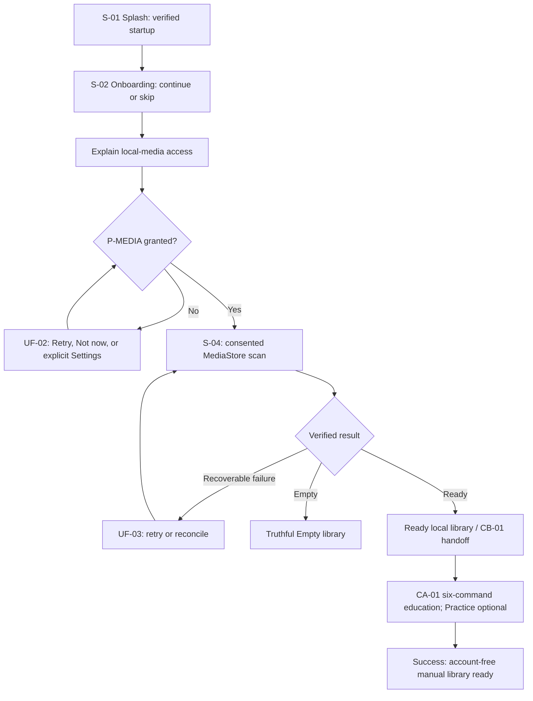

# GS-01 - First Launch to Ready Library

**Status:** **APPROVED - Stage 2 scenario contract**  
**Decision date:** 23 August 2026  
**Priority:** P0  
**Primary flows:** [UF-01](../UF-01_FIRST_LAUNCH_AND_EDUCATION.md) -> [UF-02](../UF-02_PERMISSION_RECOVERY.md) when needed -> [UF-03](../UF-03_LIBRARY_READINESS.md)  
**Downstream handoff:** [UF-04](../UF-04_BROWSE_AND_SEARCH.md) / `CB-01`  
**Canonical diagram:** [GS-01_FIRST_LAUNCH_TO_READY_LIBRARY.mmd](GS-01_FIRST_LAUNCH_TO_READY_LIBRARY.mmd)
**Cross-scenario validation:** [PASS - connected handoffs, recovery and authority](CROSS_SCENARIO_VALIDATION_2026-08-23.md)

## User goal and MVP boundary

A new user understands the local, account-free product, grants local-media access at the moment it is needed, and reaches a truthful Ready library without an account, backend, catalog, streaming, upload, or cloud sync. A verified Empty result is a valid truthful completion but is not the primary Golden outcome. Voice practice is optional and cannot block manual library value.

## Entry state and source of truth

- Fresh install, incomplete first-use state, or explicit non-mutating education replay.
- `S-01` routes from verified migration/local/platform state; it never fabricates readiness.
- Android permission state owns access, MediaStore owns accessible media identity/existence, and the derived local index is rebuildable.
- Any already-active playback remains owned by the Playback Service/MediaSession during replay.

## Requirement and authority mapping

| Type | Mapping |
|---|---|
| User Stories | `US-01`, `US-02` |
| Functional Requirements | `FR-01` consent, scan, index and readiness portion; UF-04 completes track/album/artist/folder browse |
| Canonical states | `S-01`, `S-02`, `S-03`, `S-04`, `CA-01`, `CA-02`, `SYS-01`, `SYS-04`, `SYS-05`; handoff `CB-01` |
| Permissions / consent | `P-MEDIA`; optional `P-MIC` only after Practice; `C-STT` only for a reviewed remote-processing mode |
| Accepted ADRs | ADR-0001 through ADR-0006 |
| Technical evidence | `TS-06` PASS; `TS-03` PASS at provider-policy level; `TS-01` applies only to the later notification boundary |

## Primary success path

1. The app verifies startup/migration state and shows the bounded Splash state (`S-01`).
2. First-use education (`S-02`) explains local playback and permits Continue or Skip without coercion.
3. Before the first scan, the app explains why local-media access is needed.
4. The user grants the Android media permission (`S-03` / `SYS-01`).
5. The app scans supported accessible audio through MediaStore and builds or reconciles the derived local index (`S-04 Scanning`).
6. The verified result becomes `S-04 Ready`; no account or network dependency is introduced.
7. The app may show `CA-01` education for exactly PLAY, PAUSE, NEXT, PREVIOUS, SEEK_BACK and PLAY_ARTIST. Skip never requests microphone access; Practice requests it only after the explicit choice.
8. The user reaches the Ready Home/Library handoff (`CB-01`) with manual controls available.

## Observable success state

- Home/Library truthfully reports Ready and exposes Songs, Artists, Albums, Folders and Search through UF-04.
- The derived index represents only currently accessible MediaStore items.
- No account, backend or streaming service is required.
- Onboarding completion and optional consent/preferences may persist locally; personal library contents do not enter analytics.

## Recovery references

| Failure point | Controlled recovery |
|---|---|
| Startup or migration failure | UF-01 concise Retry; never show false Ready |
| Media permission denied/requestable | UF-02 Retry or Not now; no crash |
| Media permission permanently denied | UF-02 explicit Settings or Not now; return rechecks all platform outcomes |
| Scan failure | UF-03 bounded Retry while preserving any last verified state |
| Revoked/moved/deleted/inaccessible media | UF-03 reconciliation; remove false playability without deleting user files |
| Empty scan result | Truthful `S-04 Empty`; rescan/recovery remains available |
| Microphone/provider/consent decline | Manual library remains available; provider failure is not presented as a permission failure |

## Data, privacy, analytics, accessibility

- No raw audio, transcript, title, artist, album, folder, filename, path, URI, MediaStore ID, account identifier, or library contents may be logged.
- This scenario requires no product analytics event. Analytics failure is invisible and cannot block readiness.
- Purpose text, permission outcomes, Retry/Not now/Settings actions, progress and Empty/Ready states require TalkBack labels, scalable text, sufficient contrast, and at least 48dp actionable targets.
- No Driving Mode claim is created by this scenario.

## Open downstream evidence and non-claims

The scenario contract is approved because its User Flows, ADRs and spike contracts are closed at their recorded levels. Production scan performance, final permission copy, Wireframes, Software Architecture mechanics, physical-device release evidence and Beta results remain downstream. This document does not claim a production speech provider or new physical/OEM execution.

## Canonical flow

## Review decision

**APPROVED / SOURCE-ALIGNED.** Product, Design-contract, Android-contract, QA-testability, Privacy and Governance coverage is consolidated in [Stage 2 sign-off](STAGE_2_SIGNOFF_2026-08-23.md). No unrecorded reviewer identity or runtime result is asserted.
