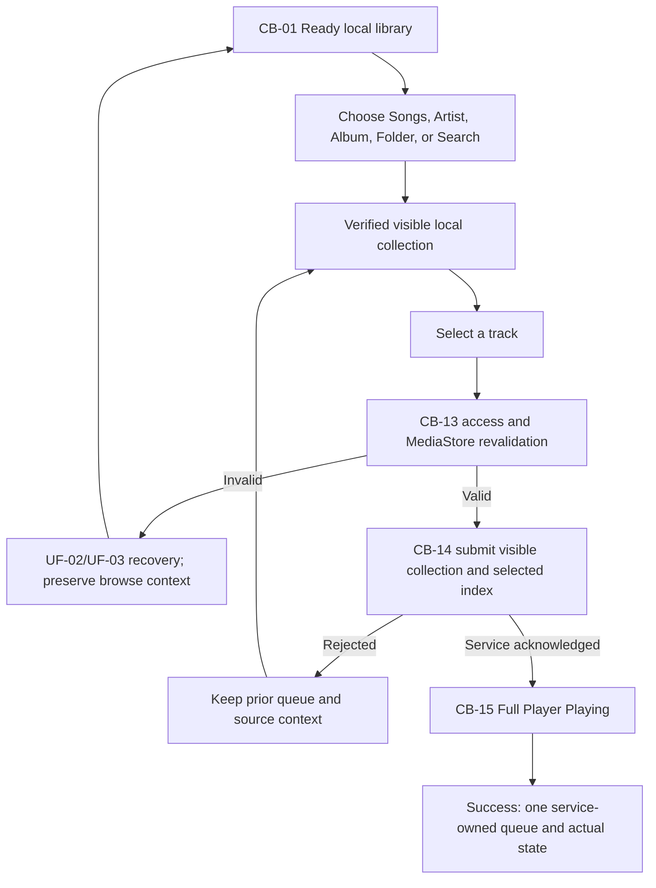

# GS-02 - Find Music and Start Playback

**Status:** **APPROVED - Stage 2 scenario contract**  
**Decision date:** 23 August 2026  
**Priority:** P0  
**Primary flows:** [UF-04](../UF-04_BROWSE_AND_SEARCH.md) -> [UF-05](../UF-05_MANUAL_PLAYBACK_AND_QUEUE_CONTROL.md)  
**Recovery owners:** [UF-02](../UF-02_PERMISSION_RECOVERY.md), [UF-03](../UF-03_LIBRARY_READINESS.md)  
**Canonical diagram:** [GS-02_FIND_MUSIC_AND_START_PLAYBACK.mmd](GS-02_FIND_MUSIC_AND_START_PLAYBACK.mmd)

## User goal and MVP boundary

A user with a verified local library finds an accessible song through Songs, Artists, Albums, Folders or local Search, selects it, and receives acknowledged playback from the single service-owned player. The selection creates no streaming/catalog fallback, playlist editor, append behavior, shuffle, repeat, wrap, account or second playback authority.

## Entry state and source of truth

- `CB-01 Home / Library Ready` after UF-03 has verified accessible local media.
- MediaStore owns accessible media existence/identity; the local index supplies rebuildable browse/search projections.
- Search queries and browse context are transient UI state.
- The Playback Service/MediaSession alone owns the accepted queue, current item and playback state.

## Requirement and authority mapping

| Type | Mapping |
|---|---|
| User Stories | `US-02`; supports the manual-value precondition for `US-03` |
| Functional Requirements | completes `FR-01`; begins the manual-player portion of `FR-02` |
| Canonical states | `CB-01` through `CB-14`; success `CB-15`; applicable recovery `CB-19`, `CB-21` |
| Permissions / consent | `P-MEDIA`; `P-SETTINGS` only through explicit UF-02 recovery; no mic or cloud consent |
| Accepted ADRs | ADR-0001, ADR-0002, ADR-0003, ADR-0006 |
| Technical evidence | `TS-02` lifecycle boundary PASS; `TS-06` MediaStore/reconciliation PASS; `TS-08` applies only if later P1 restore is needed |

## Primary success path

1. The user starts from `CB-01` with a Ready local library and an optional truthful mini-player.
2. The user chooses Songs, an Artist, an Album, a Folder, or opens local Search.
3. The derived index returns a verified visible collection (`CB-02`/`04`/`06`/`08`/`10`). Search never falls back to a network catalog.
4. The user selects one track from that visible collection.
5. `CB-13` revalidates Android access and MediaStore identity before playback submission.
6. At `CB-14`, the app submits the visible local collection in its visible order plus the selected index to the Playback Service.
7. Only after service acknowledgement does the queue replace the prior queue and the UI show the actual state.
8. The Full Player reaches `CB-15 Playing` with authoritative item, queue, supported controls and current state.

## Observable success state

- Audio for the selected accessible local item is playing.
- Full Player and any mini-player observe the same MediaSession snapshot.
- The accepted queue equals the visible local collection in visible order; no append/wrap/repeat/shuffle behavior is invented.
- Back returns to the preserved browse/search context without stopping service-owned playback.

## Recovery references

| Failure point | Controlled recovery |
|---|---|
| No local Search result (`CB-11`) | Preserve query; edit, clear, retry or return to Browse; no online fallback |
| Search/index error (`CB-12`) | Preserve verified library/query; retry/edit/clear; UF-03 only if index truth is stale |
| Revoked/stale/moved/deleted selection (`CB-13`) | UF-02/UF-03, then return with source context preserved |
| Service rejects queue/start (`CB-14`) | Keep prior verified queue and browse/search context; retry or select another track |
| Corrupt/inaccessible item (`CB-19`) | Bounded forward skip; terminal Paused/Completed if no playable item; reconcile through UF-03 |
| Controller unavailable (`CB-21`) | Reconnect to the same service and request a complete snapshot; never create a player |

## Data, privacy, analytics, accessibility

- Browse/search queries, results, queue contents and personal media metadata are prohibited from telemetry.
- Only a reviewed coarse `player_error` may be emitted on failure; telemetry is non-authoritative and non-blocking.
- Lists, Search input, rows, pending selection and playback controls require labeled TalkBack semantics, scalable text, non-color-only states and at least 48dp actions.
- Browse/Search and Queue lists are unavailable in Driving Mode.

## Open downstream evidence and non-claims

The scenario is approved as an implementation-independent contract. Final UI/Wireframes, exact query mechanics, queue concurrency mechanics, production Media3 wiring, device performance, final 5,000-file evidence and release QA remain downstream. The accepted TS-06 historical evidence/waiver and 23 August automated revalidation remain separate; this document creates no new physical measurement.

## Canonical flow

## Review decision

**APPROVED / SOURCE-ALIGNED.** Product, Design-contract, Android-contract, QA-testability, Privacy and Governance coverage is consolidated in [Stage 2 sign-off](STAGE_2_SIGNOFF_2026-08-23.md). No implementation or release evidence is implied.
