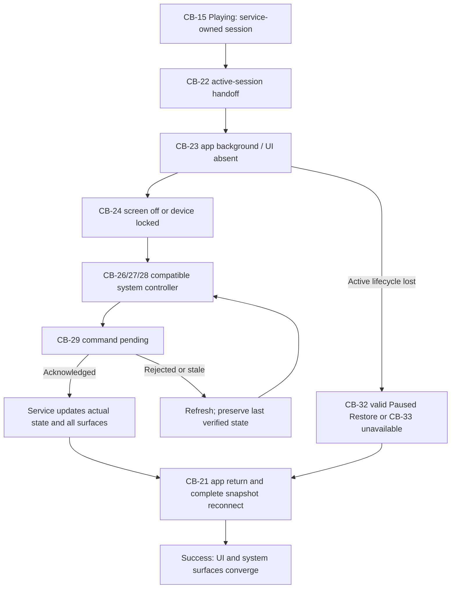

# GS-03 - Continue Playback Outside the App

**Status:** **APPROVED - Stage 2 scenario contract**  
**Decision date:** 23 August 2026  
**Priority:** P0 continuity with separable P1 Paused Restore  
**Primary flows:** [UF-05](../UF-05_MANUAL_PLAYBACK_AND_QUEUE_CONTROL.md) -> [UF-06](../UF-06_BACKGROUND_AND_SYSTEM_CONTROLS.md)  
**Route/interruption handoff:** [UF-11](../UF-11_INTERRUPTION_AUDIO_ROUTE.md)  
**Canonical diagram:** [GS-03_CONTINUE_PLAYBACK_OUTSIDE_APP.mmd](GS-03_CONTINUE_PLAYBACK_OUTSIDE_APP.mmd)
**Cross-scenario validation:** [PASS - connected handoffs, recovery and authority](CROSS_SCENARIO_VALIDATION_2026-08-23.md)

## User goal and MVP boundary

Music continues truthfully while the UI is backgrounded, absent or the screen is off, and compatible notification, lock-screen, headset/Bluetooth and vehicle media-key controllers remain synchronized with one MediaSession. This is not Android Auto UI, Cast, streaming, a guarantee that every OEM exposes every surface, or permission to invent a second player.

## Entry state and source of truth

- `CB-15 Playing`, or another acknowledged service-owned `CB-16/17` state with a valid current session.
- Playback Service/MediaSession owns live queue, item, state, position and supported actions.
- Notification, lock screen, external controls and returning UI are controllers only.
- P0 live continuity is distinct from P1 local Paused Restore after actual service lifecycle loss.

## Requirement and authority mapping

| Type | Mapping |
|---|---|
| User Stories | `US-03` |
| Functional Requirements | completes `FR-02`; `FR-08` for the separable Paused Restore branch |
| Canonical states | `CB-15/16/17`, `CB-21` through `CB-33` |
| Permissions / consent | contextual `P-NOTIF`; explicit `P-SETTINGS`; `P-MEDIA` only when validating a restored item |
| Accepted ADRs | ADR-0001, ADR-0002, ADR-0003, ADR-0006 |
| Technical evidence | `TS-01`, `TS-02`, `TS-08` PASS; 23 August TS-01 service-ownership revalidation PASS on AOSP API 29/31/34 |

## Primary success path

1. Playback is acknowledged as `CB-15 Playing` by the service.
2. The activity leaves the foreground and enters `CB-22`/`CB-23`; the UI does not transfer or duplicate player ownership.
3. The device locks or the screen turns off (`CB-24`) while playback continues through the valid route.
4. Where the platform exposes them, notification/lock/external media controls (`CB-26`/`27`/`28`) display actual MediaSession state and only supported actions.
5. A supported Play/Pause/Next/Previous command enters `CB-29` and is sent exactly once to the same service.
6. Until acknowledgement, every surface retains the last verified state; no optimistic state becomes authority.
7. The service acknowledges, updates the actual session, and all connected surfaces converge.
8. When the user returns, `CB-21` reconnects to the same service and requests a complete snapshot before showing the current player state.

## Observable success state

- Playback continuity and controls reflect the one service-owned MediaSession.
- Screen-off/background transitions do not create a second player, false empty queue, false Paused state or unintended restart.
- A returning UI displays the complete acknowledged queue/item/state/position snapshot.
- If a compatible system surface is absent, product state remains truthful rather than being reported as Stopped.

## Recovery references

| Failure point | Controlled recovery |
|---|---|
| Notification permission denied/unavailable (`CB-30/31`) | Playback and app controls continue; optional explicit Settings; no coercive loop |
| Controller/session reconnect (`CB-21`) | Reconnect to the same service; preserve last verified state until complete snapshot |
| System command rejection/timeout (`CB-29`) | Refresh actual service state; safe retry only where valid |
| OEM lifecycle event (`CB-25`) | Detect whether service still exists; never promise survival or stop without evidence |
| Active lifecycle lost with valid snapshot | `CB-32` restores explicitly Paused; Resume is required and revalidated |
| Invalid/no restore | `CB-33` returns to Home/Library; never delete user media |
| Call/focus/route event | Handoff to UF-11 / GS-05; route disconnect immediately safe-pauses |

## Data, privacy, analytics, accessibility

- Personal media metadata, queue contents, positions, device identifiers and external-surface data remain prohibited from telemetry.
- A reviewed coarse player/lifecycle error may be recorded; analytics cannot control playback or delay recovery.
- Platform controls use native accessibility semantics. App reconnect, permission explanation and fallback actions require TalkBack, scalable text, sufficient contrast and non-color-only state.
- Compatible vehicle media keys are supported as system controls; no Android Auto interface is introduced.

## Open downstream evidence and non-claims

TS-01/02/08 evidence is accepted at its recorded level. Final production foreground-service mechanics, exact OEM notification behavior beyond accepted evidence/waivers, physical Pixel/Xiaomi rows, vehicle/head-unit release tests and Beta stability remain downstream. This scenario definition does not claim that those tests were newly executed.

## Canonical flow

## Review decision

**APPROVED / SOURCE-ALIGNED.** Product, Design-contract, Android-contract, QA-testability, Privacy and Governance coverage is consolidated in [Stage 2 sign-off](STAGE_2_SIGNOFF_2026-08-23.md). P0 live continuity and P1 Paused Restore remain explicitly separate.
