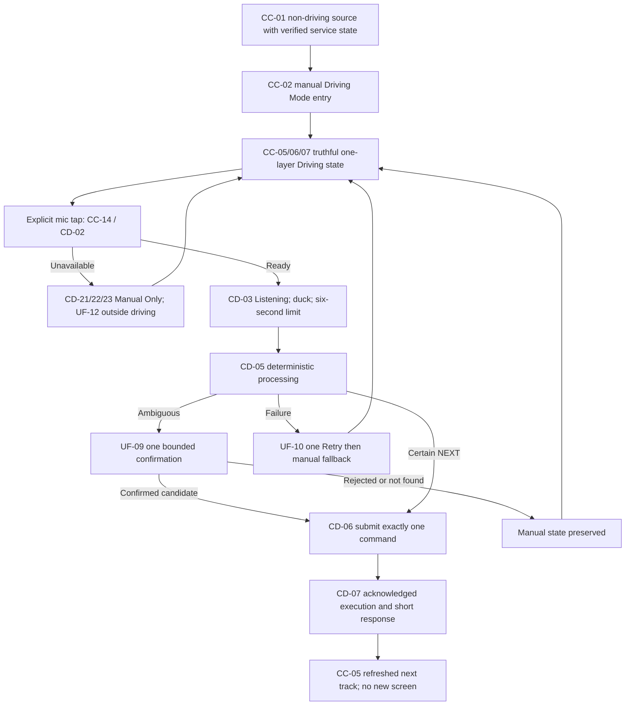

# GS-04 - Drive and Execute a Direct Voice Command

**Status:** **APPROVED - Stage 2 scenario contract**  
**Decision date:** 23 August 2026  
**Priority:** P0; selected-Bluetooth suggestion remains separable P1  
**Primary flows:** [UF-07](../UF-07_DRIVING_MODE.md) -> [UF-08](../UF-08_DIRECT_VOICE.md)  
**Required recovery flows:** [UF-09](../UF-09_AMBIGUITY_NOT_FOUND.md), [UF-10](../UF-10_TIMEOUT_RETRY.md), [UF-11](../UF-11_INTERRUPTION_AUDIO_ROUTE.md), [UF-12](../UF-12_SETTINGS_PRIVACY.md)  
**Canonical diagram:** [GS-04_DRIVE_AND_EXECUTE_DIRECT_VOICE.mmd](GS-04_DRIVE_AND_EXECUTE_DIRECT_VOICE.mmd)

## User goal and MVP boundary

From an explicitly entered Driving Mode, the user taps the microphone, says the direct supported command “Next song,” and the next local track starts after one acknowledged command, with a response of at most one sentence and no new screen. This is Push-to-Talk only: no wake word, open conversation, typing, deep navigation, online music catalog, or approximate intent execution.

## Entry state and source of truth

- A verified Playback Service snapshot is reachable from Home/Library, Full Player or a synchronized system return surface (`CC-01`).
- Manual P0 entry is the primary path. A selected-device connection may offer a dismissible P1 suggestion but never opens Driving Mode automatically.
- MediaSession owns playback; the Voice coordinator owns only the transient recognition attempt; STT/TTS/analytics never own player truth.
- An approved provider mode and English capability must be established, or the path fails closed to Manual Only.

## Requirement and authority mapping

| Type | Mapping |
|---|---|
| User Stories | `US-04`, `US-05`; recovery preserves `US-06`, `US-07` |
| Functional Requirements | `FR-04`, `FR-05`, `FR-06`; `FR-07` optional suggestion branch |
| Canonical states | `CC-01` through `CC-18`; `CD-01` through `CD-24`; primary `CC-02 -> CC-05/06 -> CC-14 -> CD-02/03/05/06/07` |
| Permissions / consent | JIT `P-MIC`; `C-STT` for reviewed remote processing; optional `P-BT`; `P-SETTINGS` only outside active Driving Mode |
| Accepted ADRs | ADR-0001 through ADR-0006 |
| Technical evidence | `TS-03`, `TS-07`, `TS-09` PASS at recorded policy/reference levels; adjacent `TS-04/05` control interruptions/routes |

## Primary success path

1. The user explicitly chooses Enter Driving Mode from `CC-01`.
2. `CC-02` obtains a complete service snapshot and enters `CC-05 Playing`, `CC-06 Paused/Ended`, or `CC-07 No Track`; no UI-owned state is fabricated.
3. The screen presents one layer: title, artist, artwork/placeholder, four large controls, microphone and immediate Exit.
4. The user taps the microphone. Only then does `CC-14`/`CD-02` evaluate microphone permission and approved provider capability.
5. `CD-03` starts Listening, ducks music, exposes Cancel/Exit, and enforces the six-second limit.
6. When speech ends, capture and ducking settle; `CD-05` deterministically maps only the six English intents.
7. A certain `NEXT` result enters `CD-06` and submits exactly one Next command to the Playback Service.
8. The service acknowledges the new current item. `CD-07` refreshes actual MediaSession state and provides at most one short spoken sentence.
9. Driving Mode returns to `CC-05` with the next track/title updated and no additional destination or list opened.

## Observable success and performance acceptance

- Exactly one acknowledged Next command changes playback to the next local queue item.
- Title/state update from the service snapshot; response is at most one sentence; no extra screen opens.
- Voice-command P95 target is under 2.5 seconds after end of speech. The scenario defines the acceptance target but does not claim a field/Beta measurement.
- Exit remains immediately reachable throughout pending, success and failure states.

## Recovery references

| Failure point | Controlled recovery |
|---|---|
| Controller snapshot unavailable | `CC-03/04`; retry or return to prior non-driving surface |
| No current track | `CC-07`; at most one revalidated last-item offer, otherwise Exit to UF-03/04 |
| Mic denied/revoked | `CD-21`; Manual Only; explicit setup only outside active Driving Mode |
| Provider/language unavailable or cloud disclosure incomplete/declined | `CD-22/23`; Manual Only; UF-12 outside driving; no false offline label |
| Ambiguous/two artists | UF-09 one bounded confirmation; execute only a presented confirmed candidate |
| Unknown/unsupported/not-found/missing artist | UF-09 safe terminal result; never nearest-match or guess |
| Timeout/no-match/network/audio failure | UF-10 one explicit Retry; second failure is terminal; manual controls preserved |
| Cancel/Exit/stale callback | `CD-24`; cancel recognizer, ignore stale callbacks, release ducking |
| Call/focus/route interruption | `CC-16` -> UF-11/GS-05; no surprise output or auto-resume |

## Data, privacy, analytics, accessibility and driving

- Allowed events use only approved enum/bucket fields: `driving_mode_started`, `voice_button_pressed`, `intent_detected`, `intent_failed`, `command_executed`, `manual_correction`, `session_completed`.
- Raw audio, transcript, exact score, candidate/artist/title, queue/library contents, precise position, location and Bluetooth device identity are prohibited.
- Targets are at least 48dp with high contrast, scalable text, stable TalkBack order and non-color-only state. Motion and spoken feedback are short.
- No typing, Search, Queue/Browse list, Settings, nested menu or long result list exists in active Driving Mode.

## Open downstream evidence and non-claims

TS-03/07/09 establish fail-closed provider policy and deterministic reference behavior, not production OEM provider availability, legal copy, road-noise accuracy or Beta KPI. Final provider/legal enablement, physical stationary/in-car runs on three vehicles/head units, exact production confidence adoption, Wireframes and Software Architecture remain downstream release gates.

## Canonical flow

## Review decision

**APPROVED / SOURCE-ALIGNED.** Product, Design-contract, Android-contract, QA-testability, Privacy and Governance coverage is consolidated in [Stage 2 sign-off](STAGE_2_SIGNOFF_2026-08-23.md). Approval is for the scenario contract, not physical vehicle/provider/Beta execution.
