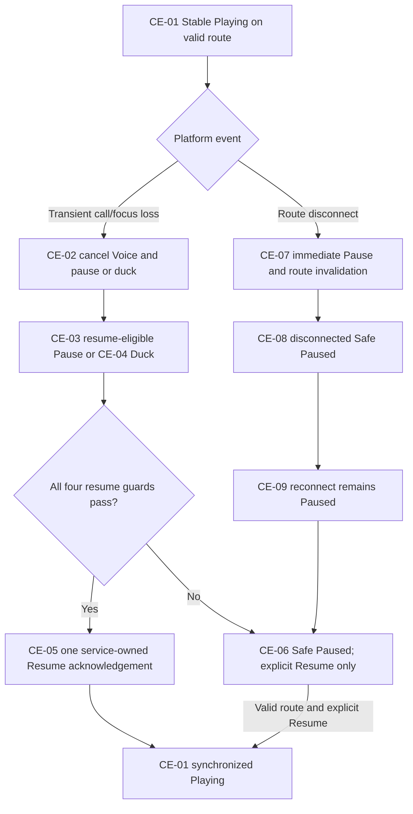

# GS-05 - Recover Safely from an Interruption

**Status:** **APPROVED - Stage 2 scenario contract**  
**Decision date:** 23 August 2026  
**Priority:** P0 stability  
**Primary flow:** [UF-11](../UF-11_INTERRUPTION_AUDIO_ROUTE.md) with state from [UF-05](../UF-05_MANUAL_PLAYBACK_AND_QUEUE_CONTROL.md) / [UF-06](../UF-06_BACKGROUND_AND_SYSTEM_CONTROLS.md)  
**Control/recovery surface:** [UF-12](../UF-12_SETTINGS_PRIVACY.md) where an explicit setting or platform recheck is required  
**Canonical diagram:** [GS-05_RECOVER_SAFELY_FROM_INTERRUPTION.mmd](GS-05_RECOVER_SAFELY_FROM_INTERRUPTION.mmd)

## User goal and MVP boundary

When a call, Audio Focus event or Audio Route change interrupts playback, the app avoids simultaneous/unintended output, preserves truthful state, and either conditionally resumes after a transient interruption or remains safely Paused for explicit user action. Reconnect alone never auto-resumes, and no hidden device identity, call data or personal media metadata is collected.

## Entry state and source of truth

- `CE-01 Stable Playing` from an acknowledged service-owned queue on a valid route.
- Playback Service/MediaSession owns playback and queue; current platform focus/call/route state gates actual output.
- A Voice attempt, if active, is transient and must be cancelled before interruption handling settles.
- UI, notification, route callbacks and analytics are observers/inputs, never separate playback authorities.

## Requirement and authority mapping

| Type | Mapping |
|---|---|
| User Stories | stability extension of `US-03`; preserves manual/Driving control for `US-04` through `US-07` |
| Functional Requirements | `FR-03`; continuity interaction with `FR-02` |
| Canonical states | `CE-01` through `CE-14`; `CC-16` when interruption occurs in Driving Mode; explicit settings/recheck `CE-18/19` where applicable |
| Permissions / consent | platform focus/call/route state; no new runtime permission; Voice capture is cancelled; explicit `P-SETTINGS` only outside active Driving Mode |
| Accepted ADRs | ADR-0001, ADR-0002, ADR-0003, ADR-0004, ADR-0006 |
| Technical evidence | `TS-04` conditional focus/call policy and `TS-05` route safety PASS at deterministic reference-policy level; `TS-02` supports one service boundary |

## Primary success path - transient call/focus interruption

1. Playback begins in `CE-01` on a valid route.
2. A transient call/focus event enters `CE-02`; any Voice recognition is cancelled and stale callbacks become ineffective.
3. The service follows platform policy by pausing (`CE-03`) or ducking (`CE-04`) without creating a second state authority.
4. When the transient event ends, automatic Resume is eligible only if all four guards remain true: playback was active before the interruption, the pause was policy-owned, the user did not manually pause, and the route/session is still valid.
5. If all guards pass, the service performs exactly one Resume and acknowledges `CE-05`.
6. All app/system surfaces refresh to `CE-01 Playing`; no simultaneous audio, duplicate Resume or optimistic UI state occurs.

## Mandatory route-disconnect safety branch

1. A wired/Bluetooth route disconnect immediately enters `CE-07`, pauses playback and invalidates the old route generation.
2. `CE-08` remains safely Paused while no approved route exists; playback cannot leak to the speaker.
3. Reconnection enters `CE-09` and remains Paused.
4. Only an explicit Resume on a revalidated valid route may return to `CE-01`.

## Observable success state

- A transient call/focus interruption resumes only under the complete four-guard policy.
- Manual pause, permanent focus loss, route change or invalid session always wins over auto-resume.
- Route disconnect immediately pauses; reconnect never auto-resumes.
- Every controller reflects the same service-owned acknowledged state and an active Driving Mode retains immediate Exit.

## Recovery references

| Failure point | Controlled recovery |
|---|---|
| Any resume guard fails | `CE-06 Safe Paused`; explicit Resume only on a valid route |
| Permanent focus loss | `CE-10`; eligibility cleared; manual future start only |
| Callback/service rejection | `CE-11`; refresh actual service/route truth, remain paused or Exit |
| Route remains unavailable | `CE-08`; no playback command may start on an unsafe route |
| Corrupt current item | `CE-12/13` bounded controlled skip; no duplicate dispatch |
| No playable item remains | `CE-14`; terminal Paused/Ended and return to UF-04/05; access recovery through UF-02/03 |
| Settings/provider action needed | UF-12 explicit handoff outside active Driving Mode, then platform/provider truth is re-read |

## Data, privacy, analytics, accessibility and driving

- No call identity, phone number, contact, device name/address/ID, personal media identity, queue contents, raw audio or transcript may be logged.
- A reviewed coarse `route_type`, `player_error.error_code`, or session bucket may be emitted; it never delays pause or Resume policy.
- Paused/ducked/disconnected/error states require non-color-only cues and TalkBack announcements without excessive speech.
- Manual Resume and Exit are large, reachable actions in Driving Mode; reconnection cannot surprise the user with audio.

## Open downstream evidence and non-claims

TS-04/05 close deterministic reference policies only. Physical calls, OEM focus callbacks, audible speaker-leak checks, wired/Bluetooth timing, three vehicles/head units, 99% crash-free evidence and release/Beta results remain downstream. This scenario does not claim those field tests have passed.

## Canonical flow

## Review decision

**APPROVED / SOURCE-ALIGNED.** Product, Design-contract, Android-contract, QA-testability, Privacy and Governance coverage is consolidated in [Stage 2 sign-off](STAGE_2_SIGNOFF_2026-08-23.md). This approves the deterministic scenario contract, not physical/OEM/vehicle release evidence.
