# 01.6 - State Inventory and Traceability

- **Product:** Music Copilot MVP v1.0
- **Gate:** Stage 1 - Requirement Traceability Matrix
- **Coverage:** UF-01, UF-02, UF-03 (Cluster A)
- **Canonical diagram source:** [01_6_STATE_INVENTORY_AND_TRACEABILITY.mmd](01_6_STATE_INVENTORY_AND_TRACEABILITY.mmd)
- **Gate result:** PASS for matrix completeness and internal consistency
- **Boundary:** This pass does not complete FR-01, approve ADR-0001 through ADR-0006, close Issues #2 or #3, approve UF-04 through UF-13, start Wireframes, approve final Software Architecture, or authorize implementation.

## 1. Authority and source exclusion

Evidence order used for this record:

1. Music_Copilot_PRD_v1_EN_Clarified.pdf - official product authority.
2. Music_Copilot_MVP_v1_EN.pdf - official delivery, priority, User Story, state, and acceptance authority.
3. Music_Copilot_User_Flow_Phase_0_Foundation_v1.0_EN.pdf - approved drafting map and decision routing.
4. ADR-0001 through ADR-0006 - architectural influence, each currently Proposed.
5. Music_Copilot_System_Architecture_MVP_v1_EN.pdf and Music_Copilot_Code_and_Technical_Documentation_MVP_v1_EN.pdf - technical interpretation that may not add product scope.

**Explicit exclusion:** Music_Copilot_User_Flow_Phase_1_First_Readiness_v1.0_EN.pdf was not used to create, correct, validate, or approve this record.

## 2. Gate definition and result

Stage 1 passes only when every Cluster A flow records all of the following explicitly: Flow ID, user goal, priority, User Story, Functional Requirement, screens/states, influencing ADRs, failure/recovery, data/permissions, and open assumptions/evidence.

All required fields are present in section 4. Open items remain visible rather than being converted into false completion claims.

## 3. Corrected state inventory

| ID | Surface or state | Trigger | Required success, failure, and recovery contract |
|---|---|---|---|
| S-01 | Splash - Loading, Migration Error | Cold/warm start | Route from verified local and platform state; concise Retry; never fabricate library or playback state. |
| S-02 | Onboarding - First Run, Incomplete Resume, Skip, Replay | Fresh install, interrupted first use, explicit Settings replay | Continue and Skip record completion; resume from the actual pending step; replay preserves permissions, library, queue, and active playback. |
| S-03 | Permissions - Granted, Denied-requestable, Permanently Denied | Capability first needed or explicit recovery | Granted resumes the blocked action; Denied exposes Retry and Not now; permanent denial exposes explicit Settings and Not now; Settings return rechecks three distinct outcomes. |
| S-04 | Home / Library - Scanning, Empty, Ready, Recoverable Failure, Revoked-Reconciled | First scan, returning route, Rescan, reconciliation, permission/media change | Truthful readiness; Retry on recoverable failure; remove false playability after revocation; retain a verified current returning-user state without unnecessary visible scanning. |
| CA-01 | Six-Command Education - View, Skip, Replay, Practice Choice | Ready/Empty, pending education, explicit replay | Exactly PLAY, PAUSE, NEXT, PREVIOUS, SEEK_BACK, PLAY_ARTIST; Skip requests no microphone; Practice begins only after explicit choice. |
| CA-02 | Voice Access Boundary - Mic Purpose, Granted, Denied-requestable, Permanently Denied, Provider Unavailable, Cloud Consent | Explicit microphone action or selected practice | Permission outcome, provider availability, and cloud-processing consent are distinct; every failure preserves manual controls and authoritative playback. |
| SYS-01 | Android media permission dialog | After one-purpose explanation and before first scan | OS result is authoritative; denial returns to app recovery. |
| SYS-02 | Android microphone permission dialog | Explicit mic tap or selected practice only | OS result is authoritative; denial never blocks local browsing/playback. |
| SYS-03 | Notification permission boundary | Only after successful playback/background-control value exists | Deferred to UF-06 and TS-01; denial must not crash, stop playback, or falsify state. |
| SYS-04 | Android Settings | Explicit media/microphone recovery action only | On return, recheck Granted, Denied-requestable, or Still permanently denied; never auto-loop into Settings. |
| SYS-05 | Speech provider/cloud-processing boundary | After microphone grant, before Voice use | Provider unavailable is not a permission failure; cloud processing requires truthful separate consent and disclosure; exact behavior remains TS-03. |

## 4. Per-flow traceability matrix

| Flow ID | User goal | Priority | User Story | Functional Requirement | Screens and states | Influencing ADRs | Failure and recovery | Data and permissions | Open assumptions or evidence |
|---|---|---|---|---|---|---|---|---|---|
| UF-01 | Understand the product, finish or skip first-use education, reach a truthful Home / Library state, and retain manual control if Voice is declined. | P0 | US-01, US-02 | PRD first-use journey; FR-01 partial - first-use consent/readiness only; full views require UF-04. | S-01 Loading/Migration Error; S-02 First Run/Incomplete Resume/Skip/Replay; S-04 Empty/Ready handoff; CA-01; CA-02. | ADR-0001 native Android/state; ADR-0002 active playback authority on return/replay; ADR-0003 local data boundaries; ADR-0004 replaceable provider; ADR-0005 exactly six intents; ADR-0006 no account/backend/streaming. | Startup Retry; resume pending step; non-mutating replay; permission/scan recovery; microphone/provider/cloud-consent decline returns to manual controls. | DataStore-like onboarding/education flags; Android media/microphone state; MediaStore/readiness observation; no account data; no raw audio/transcript/personal media telemetry. | TS-03 provider/disclosure evidence; Issue #2 final ADR outcomes; Figma synchronization. |
| UF-02 | Recover safely from media, microphone, and later notification denial without a crash, coercive loop, or loss of manual playback control. | P0 | US-01 | FR-01 partial - media-access precondition/recovery; FR-05 microphone precondition only - Voice execution remains UF-08/UF-10. | S-03; CA-02; SYS-01/02/03/04/05; Home / Library Empty manual fallback. | ADR-0001 Android permission surfaces; ADR-0002 playback remains service-owned and truthful; ADR-0003 access/revocation reconciliation; ADR-0004 provider/consent/failure isolation; ADR-0006 no forced cloud/backend. | Denied-requestable: Retry/Not now; permanent denial: Open Settings/Not now; Settings return: three outcomes; provider unavailable and consent decline: manual fallback; revocation: reconcile false playability. | Android permission state is authoritative; MediaStore existence vs derived index; microphone requested JIT; notification deferred; consent stored locally if applicable. | TS-01 notification evidence; TS-03 provider/cloud evidence; TS-06 storage/revocation evidence; Issue #2 ADR outcomes. |
| UF-03 | Build or reconcile an account-free local library and see a truthful Scanning, Empty, Ready, failure, or revoked state. | P0 | US-02 | FR-01 partial - scan/index/readiness; Songs/Artists/Albums/Folders browsing/search completion remains UF-04. | S-04 Scanning/Empty/Ready/Recoverable Failure/Revoked-Reconciled; SYS-01 media access; handoff to UF-02 recovery. | ADR-0001 observable Android state; ADR-0002 active playback remains service-owned during routing; ADR-0003 MediaStore authority and rebuildable index; ADR-0006 local-only/no account/backend/streaming. | Initial/incremental scan; Retry after recoverable failure; preserve verified prior state where possible; reconcile moved/deleted/inaccessible media; never require reinstall by default. | MediaStore = accessible media existence/identity; local DB index = derived/rebuildable; media permission-bound; telemetry non-authoritative and excludes personal media metadata. | TS-06 scoped-storage, move/delete, interruption, incremental reconciliation and rebuild evidence; Issue #2 ADR outcomes; full FR-01 depends on UF-04. |

## 5. Product requirement coverage

| Source requirement | Priority | Cluster A mapping | Status after Stage 1 |
|---|---|---|---|
| PRD first-use journey | P0 | UF-01, UF-02, UF-03 | Covered for first-readiness behavior: two slides, contextual access, scan/readiness, six-command education, Home / Library. |
| FR-01 - consented scan and display by track/album/artist/folder | P0 | UF-01, UF-02, UF-03, UF-04 | **Partial:** Cluster A covers consent, scan, index, readiness, and recovery. UF-04 must complete browsing/search across Songs, Artists, Albums, and Folders. |
| US-01 - permissions at the right time; denial recovery and Settings | P0 | UF-01, UF-02 | Covered in Cluster A, including three-way Settings recheck and manual fallback. |
| US-02 - account-free initial/incremental local scan | P0 | UF-01, UF-03 | Covered in Cluster A at flow/specification level; executed device evidence remains TS-06. |

No Cluster A artifact claims FR-02 through FR-09 complete. Those requirements remain mapped to later flows per Phase 0.

## 6. ADR influence and governance

All six ADR source PDFs are currently Proposed; ADR-0001 and ADR-0003 are revised proposals, not Accepted records.

| ADR | Cluster A influence | Flow mapping | Governance status |
|---|---|---|---|
| ADR-0001 | Native Android 10+, Compose/state ownership, platform permission surfaces | UF-01, UF-02, UF-03 | Proposed - Revised |
| ADR-0002 | Playback service owns active playback; UI routing/replay may observe but not restart or duplicate authority | UF-01, UF-02, UF-03 | Proposed |
| ADR-0003 | MediaStore authority, derived/rebuildable index, local state, permission/revocation boundaries | UF-01, UF-02, UF-03 | Proposed - Revised |
| ADR-0004 | Replaceable Voice provider, provider failure isolation, consent/disclosure boundary | UF-01, UF-02 | Proposed |
| ADR-0005 | Deterministic allowlist of exactly six intents; no guessing | UF-01 CA-01 education and practice handoff | Proposed |
| ADR-0006 | No account, backend, cloud sync, online catalog, streaming, upload, or download | UF-01, UF-02, UF-03 | Proposed |

Issue #2 must record Accepted or Revised outcomes before these ADRs can be treated as approved architecture. Open ADR governance does not invalidate traceability; it is recorded as an open dependency.

## 7. Source-of-truth, privacy, and scope contract

- Android permission state is authoritative for access.
- MediaStore is authoritative for accessible media existence and Android identity.
- The local index is derived and rebuildable; it never proves that media remains accessible.
- The playback service/MediaSession is authoritative for active playback; UI routing never restarts it or creates a second playback truth.
- Telemetry is non-authoritative and excludes raw audio, full transcript, titles, artists, albums, folders, filenames, URIs, paths, and library contents by default.
- Cloud speech, if selected, requires separate truthful disclosure of destination, purpose, and retention before processing.
- MVP v1.0 remains Android 10+ local audio with no account, backend, sync, catalog, streaming, upload, download, distribution, Android Auto, iOS, or v1.1 scope.

## 8. Open evidence register

| ID | Open evidence | Effect |
|---|---|---|
| TS-01 | Notification/foreground-media behavior across supported Android versions | Does not block this matrix; blocks final UF-06 exact behavior. |
| TS-03 | Provider availability, language, network dependence, processing destination, consent, retention, and fallback | Does not block abstract JIT permission/manual fallback; blocks provider-specific copy and final Voice approval. |
| TS-06 | Media permission changes, moved/deleted media, interruption, incremental reconciliation, rebuild | Does not block this matrix; blocks final implementation claims for UF-03. |
| Issue #2 | Explicit Accepted or Revised result for ADR-0001 through ADR-0006 | Does not block mapping; blocks treating proposed ADRs as approved architecture. |
| UF-04 | Browse/search by Songs, Artists, Albums, and Folders | Required to complete FR-01. |
| Figma sync | Visual 01.5/01.6/01.7 must match the canonical repository behavior | Blocks use of an older Figma snapshot as approval evidence. |

## 9. Stage 1 acceptance checklist

| Check | Result |
|---|---|
| One explicit row for each of UF-01, UF-02, UF-03 | PASS |
| User goal and P0 priority recorded per flow | PASS |
| User Story and FR mapping recorded per flow | PASS |
| FR-01 correctly marked Partial until UF-04 | PASS |
| Screens and required states recorded | PASS |
| ADR-0001 through ADR-0006 influence/status recorded without false acceptance | PASS |
| Failures and recoveries recorded, including three-way Settings return and provider-unavailable separation | PASS |
| Data and permission boundaries recorded per flow | PASS |
| Open assumptions/evidence recorded per flow | PASS |
| Markdown/Mermaid canonical parity validated | PASS after repository synchronization |
| Excluded Phase 1 First Readiness PDF not used | PASS |
| No scope creep beyond MVP v1.0 | PASS |

**Stage 1 result:** PASS for Cluster A Traceability Matrix completeness. FR-01, the full User Flow set, ADR governance, technical evidence, Figma synchronization, and downstream approval gates remain explicitly open.

## 10. Canonical diagram

```mermaid
%%{init: {"theme": "base", "flowchart": {"curve": "stepAfter", "nodeSpacing": 44, "rankSpacing": 62, "htmlLabels": true}, "themeVariables": {"fontFamily": "Inter, Arial, sans-serif", "fontSize": "14px", "lineColor": "#667085", "textColor": "#1F2633"}}}%%
flowchart TB

    subgraph AUTH["A. AUTHORITY AND EVIDENCE"]
        direction TB
        PRD["English PRD v1.0<br/>Product authority: first-use journey, FR-01, privacy, accessibility, scope"]
        MVP["English MVP v1.0<br/>Product authority: US-01, US-02, P0 acceptance and required states"]
        PH0["Phase 0 Foundation<br/>Approved drafting map: UF-01 / UF-02 / UF-03, decisions and open spikes"]
        TECH["System Architecture + Technical Documentation<br/>Technical interpretation only; cannot expand product scope"]
        ADRS["ADR influence - all status Proposed<br/>ADR-0001 through ADR-0006 mapped explicitly"]
        EXCLUDED["Excluded from evidence<br/>Music_Copilot_User_Flow_Phase_1_First_Readiness_v1.0_EN.pdf"]
    end

    subgraph FLOWS["B. CLUSTER A FLOW ROWS"]
        direction TB
        UF01["UF-01 - P0<br/>First Launch and Education<br/>US-01 + US-02; FR-01 partial"]
        UF02["UF-02 - P0<br/>Permission Denial and Settings Recovery<br/>US-01; FR-01 partial; FR-05 precondition only"]
        UF03["UF-03 - P0<br/>Local Scan and Library Readiness<br/>US-02; FR-01 partial"]
    end

    subgraph STATES["C. REQUIRED STATE COVERAGE"]
        direction TB
        S01["S-01 Splash<br/>Loading / Migration Error"]
        S02["S-02 Onboarding<br/>First Run / Incomplete Resume / Skip / Replay"]
        S03["S-03 Permissions<br/>Granted / Denied-requestable / Permanently Denied<br/>Three-way Settings-return recheck"]
        S04["S-04 Home / Library<br/>Scanning / Empty / Ready / Recoverable Failure / Revoked-Reconciled"]
        CA01["CA-01 Six-Command Education<br/>PLAY / PAUSE / NEXT / PREVIOUS / SEEK_BACK / PLAY_ARTIST"]
        CA02["CA-02 Voice Access Boundary<br/>Microphone result distinct from provider availability and cloud consent"]
    end

    subgraph CONTRACTS["D. DATA, RECOVERY, AND SCOPE CONTRACTS"]
        direction TB
        TRUTH["Authority<br/>Android permission state = access<br/>MediaStore = media existence / identity<br/>Local index = derived / rebuildable<br/>Playback service = active playback"]
        RECOVERY["Recovery<br/>No crash or dead end<br/>Retry / Not now / explicit Settings / manual fallback<br/>No automatic Settings loop"]
        PRIVACY["Privacy<br/>No raw audio, full transcript, or personal media metadata in telemetry<br/>Separate truthful cloud-processing consent if applicable"]
        SCOPE["MVP v1.0<br/>Android 10+ local audio only<br/>No account, backend, sync, catalog, streaming, upload, download, Android Auto, iOS, or v1.1"]
    end

    subgraph GAPS["E. EXPLICITLY OPEN - NOT HIDDEN"]
        direction TB
        FR01["FR-01 coverage status: PARTIAL in Cluster A<br/>UF-04 must complete Songs / Artists / Albums / Folders browsing and search"]
        ISSUE2["ADR governance: OPEN<br/>All six ADR files are Proposed until Issue #2 records Accepted or Revised outcomes"]
        TS01["TS-01 OPEN<br/>Notification and foreground-media behavior"]
        TS03["TS-03 OPEN<br/>Voice provider, network, processing destination, consent, retention, fallback"]
        TS06["TS-06 OPEN<br/>Storage permission changes, move/delete, reconciliation, rebuild"]
    end

    PRD --> UF01
    PRD --> UF02
    PRD --> UF03
    MVP --> UF01
    MVP --> UF02
    MVP --> UF03
    PH0 --> UF01
    PH0 --> UF02
    PH0 --> UF03
    TECH -. constrains .-> UF01
    TECH -. constrains .-> UF02
    TECH -. constrains .-> UF03
    ADRS -. influences .-> UF01
    ADRS -. influences .-> UF02
    ADRS -. influences .-> UF03
    EXCLUDED -. never used .-> PASS

    UF01 --> S01
    UF01 --> S02
    UF01 --> CA01
    UF01 --> CA02
    UF02 --> S03
    UF02 --> CA02
    UF03 --> S04

    S01 --> RECOVERY
    S02 --> RECOVERY
    S03 --> RECOVERY
    S04 --> RECOVERY
    CA02 --> PRIVACY
    S03 --> TRUTH
    S04 --> TRUTH
    TRUTH --> SCOPE
    PRIVACY --> SCOPE

    UF01 --> FR01
    UF02 --> FR01
    UF03 --> FR01
    ADRS --> ISSUE2
    CA02 --> TS03
    S03 --> TS01
    S04 --> TS06

    PASS["STAGE 1 TRACEABILITY MATRIX GATE - PASS<br/>Every Cluster A flow has an explicit goal, priority, US/FR mapping, states, ADR influence, recovery, data/permission boundary, and open-evidence field.<br/>This does not mean FR-01, Issue #2, Issue #3, or the complete User Flow set is finished."]

    UF01 --> PASS
    UF02 --> PASS
    UF03 --> PASS
    RECOVERY --> PASS
    SCOPE --> PASS
    FR01 --> PASS
    ISSUE2 --> PASS
    TS01 --> PASS
    TS03 --> PASS
    TS06 --> PASS

    classDef authority fill:#EAF2FF,stroke:#3776D6,color:#1F2633,stroke-width:1.5px;
    classDef flow fill:#E1F9FA,stroke:#16BEC7,color:#1F2633,stroke-width:1.5px;
    classDef state fill:#FFF4D6,stroke:#C68817,color:#1F2633,stroke-width:1.5px;
    classDef contract fill:#EEF1F5,stroke:#667085,color:#1F2633,stroke-width:1.5px;
    classDef open fill:#FFE8E8,stroke:#C63B3B,color:#1F2633,stroke-width:1.5px;
    classDef pass fill:#EAF8EE,stroke:#2E8B4B,color:#1F2633,stroke-width:2px;

    class PRD,MVP,PH0,TECH,ADRS,EXCLUDED authority;
    class UF01,UF02,UF03 flow;
    class S01,S02,S03,S04,CA01,CA02 state;
    class TRUTH,RECOVERY,PRIVACY,SCOPE contract;
    class FR01,ISSUE2,TS01,TS03,TS06 open;
    class PASS pass;

    style AUTH fill:transparent,stroke:#C7CED9,stroke-width:1px
    style FLOWS fill:transparent,stroke:#C7CED9,stroke-width:1px
    style STATES fill:transparent,stroke:#C7CED9,stroke-width:1px
    style CONTRACTS fill:transparent,stroke:#C7CED9,stroke-width:1px
    style GAPS fill:transparent,stroke:#C7CED9,stroke-width:1px
```

