# 01.6 - State Inventory and Traceability

- **Product:** Music Copilot MVP v1.0
- **Phase:** User Flow Phase 1 - Cluster A First Readiness
- **Coverage:** UF-01, UF-02, UF-03
- **Figma source:** `01.6 / State Inventory and Traceability` - node `23:30`
- **Repository source:** [`01_6_STATE_INVENTORY_AND_TRACEABILITY.mmd`](01_6_STATE_INVENTORY_AND_TRACEABILITY.mmd)
- **Review status:** The Figma snapshot is directionally correct but requires synchronization with the corrected Cluster A flow. This file is the corrected canonical repository record.
- **Approval boundary:** This artifact does not close Issue #3, approve UF-04 through UF-13, approve low-fidelity Wireframes or final Software Architecture, or authorize implementation. Final complete User Flow approval remains gated by Issue #2 / ADR-register alignment and completion of the remaining flow set.

## Review findings

The Figma state inventory and traceability tables preserve the core PRD/MVP scope, but they are not fully complete after the correction of `01.5 / Combined Cluster A Flow`.

### Correct items in the Figma snapshot

- `S-01` Splash includes Loading and recoverable Migration Error.
- `S-03` distinguishes Granted, Denied, and Permanent denial.
- `S-04` includes Scanning, Empty, and Ready.
- `SYS-01` through `SYS-04` correctly identify media permission, microphone permission, notification deferral, and explicit Android Settings recovery.
- PRD first-use, FR-01, US-01, US-02, D-004, D-006/D-007/D-008, D-009/D-014/D-020, TS-01, and TS-06 are represented.
- No account, backend, streaming, sync, catalog, upload, download, or other outside-MVP capability is introduced.

### Required corrections

1. `S-02` must include interrupted first-use resume, completion recording for both Continue and Skip, and non-mutating Settings replay.
2. `S-03` must record the full three-way Settings-return recheck: Granted, Denied/requestable, and Still Permanently Denied.
3. `S-04` must include Recoverable Failure and Revoked/Reconciled states and must not imply that every returning user enters visible Scanning.
4. Six-command education needs an explicit Cluster A state record because it is user-visible behavior even though it is not a separate top-level application destination.
5. Microphone/provider/cloud-consent behavior needs a separate Cluster A boundary record, including provider unavailable, manual fallback, and separate cloud-processing consent.
6. Traceability must include D-005, D-016, D-028, D-030, and TS-03.
7. The source-of-truth contract must explicitly distinguish Android permission state, MediaStore, the derived local index, and the playback service.

## Corrected state inventory

| ID | Surface / state | Trigger | Required success, failure, and recovery contract |
|---|---|---|---|
| `S-01` | Splash - Loading / Migration Error | Cold or warm start | Route by startup policy; concise Retry; never fabricate library or playback state. |
| `S-02` | Onboarding - First Run / Incomplete Resume / Skip / Replay | Fresh install, interrupted first use, or Settings replay | Continue and Skip record completion locally; resume from the actual pending step; replay preserves permissions, library, queue, and active playback. |
| `S-03` | Permissions - Granted / Denied / Permanently Denied | Capability first needed or explicit recovery | Granted continues the blocked action; Denied preserves Retry and Not now; Permanently Denied exposes Settings only after explicit action; Settings return rechecks all outcomes. |
| `S-04` | Home / Library - Scanning / Empty / Ready / Recoverable Failure / Revoked-Reconciled | Startup, first scan, Rescan, reconciliation, permission or media change | Ready and Empty are truthful; recoverable failure offers Retry; revocation removes false playability; a verified current returning-user state does not require visible Scanning. |
| `CA-01` | Six-Command Education - View / Skip / Replay / Practice Choice | Valid Ready or Empty state, pending education, or explicit replay | Exactly PLAY, PAUSE, NEXT, PREVIOUS, SEEK_BACK, PLAY_ARTIST; Skip requests no microphone; Practice begins only after explicit user choice. |
| `CA-02` | Voice Access and Consent Boundary - Mic Purpose / Granted / Denied / Permanently Denied / Provider Unavailable / Cloud Consent | Explicit microphone action or user-selected practice | Manual controls remain available; Settings is optional and not automatic; cloud processing requires separate destination, purpose, and retention disclosure; no guaranteed-offline claim without evidence. |
| `SYS-01` | Android media permission dialog | After one-purpose explanation and before first scan | Denial returns to app recovery; permanent denial exposes explicit Settings action. |
| `SYS-02` | Android microphone permission dialog | Explicit mic tap or practice only | Denial and permanent denial preserve manual browsing and playback. |
| `SYS-03` | Notification permission boundary | After successful playback and background-control value exist | Deferred to UF-06 / TS-01; denial must not crash, stop playback, or falsify player state. |
| `SYS-04` | Android Settings | Explicit media or microphone/provider recovery action | Return always rechecks the relevant real condition; still denied returns to explanation or manual fallback. |
| `SYS-05` | STT provider / cloud-processing boundary | Voice provider requires capability or processing disclosure | Availability, language support, network dependence, destination, retention, and fallback remain evidence-gated by TS-03. |

## Requirement and decision traceability

| Source | Priority / status | Covered by | Corrected Cluster A evidence |
|---|---|---|---|
| PRD first-use journey | P0 | UF-01 / UF-02 / UF-03 | Two slides, contextual media access, scan/readiness, six-command education, Home / Library. |
| FR-01 local scan and views | P0 | UF-01 / UF-02 / UF-03 | Media access before scan; initial/incremental scan; Scanning/Empty/Ready/error/revocation; Songs/Artists/Albums/Folders internal views. |
| MVP US-01 permission timing/recovery | P0 | UF-01 / UF-02 | One purpose at a time; Denied/Permanently Denied; Retry/Not now; explicit Settings; return recheck; no crash. |
| MVP US-02 account-free scan | P0 | UF-01 / UF-03 | No account/backend; initial/incremental scan; derived rebuildable index. |
| D-004 / D-005 | Approved for flow drafting | UF-01 / UF-03 | One Home / Library destination; returning user observes current state and active service without restarting it. |
| D-006 / D-007 / D-008 | Approved or routed | UF-01 / UF-02 / UF-03 | Media before scan; microphone just-in-time; notification contextual and deferred. |
| D-009 / D-014 / D-020 | Approved | UF-01 / UF-02 / UF-03 | Skip/replay; Settings return recheck; revocation reconciliation without false playability. |
| D-016 / D-030 | Routed or approved for UX | UF-01 / UF-02 | Replaceable provider boundary; truthful network/offline disclosure; provider unavailable preserves manual controls. |
| D-028 | Approved | UF-01 / UF-02 / UF-03 | Allowlist-only analytics; no raw audio, transcript, or personal media payload; no new Cluster A event without review. |
| TS-01 | Open evidence | UF-02 / later UF-06 | Android 10/12/14+ notification and foreground-media behavior. |
| TS-03 | Open evidence | UF-01 / UF-02 | Provider availability, language, network dependence, processing destination, consent, retention, and fallback. |
| TS-06 | Open evidence | UF-02 / UF-03 | MediaStore/scoped-storage permission changes, move/delete, incremental reconciliation, and rebuild. |

## Source-of-truth and scope contract

- Android permission state is authoritative for access.
- MediaStore is authoritative for accessible media existence and Android platform identity.
- The local index is derived and rebuildable; it is not proof that media remains accessible.
- The playback service is authoritative for active playback; Cluster A routing never restarts it from the UI.
- Telemetry is non-authoritative and never a recovery, library, identity, or playback source.
- MVP v1.0 remains Android 10+ and local-audio focused, with no account, backend, sync, catalog, streaming, upload, download, distribution, or forced cloud dependency.

## Canonical diagram

```mermaid
%%{init: {"theme": "base", "flowchart": {"curve": "stepAfter", "nodeSpacing": 46, "rankSpacing": 64, "htmlLabels": true}, "themeVariables": {"fontFamily": "Inter, Arial, sans-serif", "fontSize": "14px", "lineColor": "#667085", "textColor": "#1F2633"}}}%%
flowchart LR

    subgraph AUTH["A. PRODUCT AUTHORITY AND CLUSTER A EVIDENCE"]
        direction TB
        PRD["English PRD v1.0<br/>First-use journey, FR-01, privacy, accessibility, MVP scope"]
        MVP["English MVP v1.0<br/>US-01, US-02, P0 delivery and recovery acceptance"]
        PH0["Phase 0 Foundation<br/>D-004, D-005, D-006, D-007, D-008, D-009, D-014, D-016, D-020, D-028, D-030"]
        ADRS["Proposed ADR constraints<br/>ADR-0001 / 0003 / 0004 / 0006<br/>Not final acceptance evidence"]
        GH["GitHub evidence<br/>UF-01, UF-02, UF-03 and corrected 01.5 Combined Cluster A Flow"]
    end

    subgraph FLOWS["B. FLOW COVERAGE"]
        direction TB
        UF01["UF-01<br/>First Launch and Education"]
        UF02["UF-02<br/>Permission Denial and Settings Recovery"]
        UF03["UF-03<br/>Local Scan and Library Readiness"]
    end

    subgraph APP["C. APPLICATION AND CLUSTER-LOCAL STATE INVENTORY"]
        direction TB
        S01["S-01 Splash<br/>Loading / Migration Error<br/>Retry without fabricated library or playback state"]
        S02["S-02 Onboarding<br/>First Run / Incomplete Resume / Skip / Replay<br/>Continue and Skip record completion; Replay is non-mutating"]
        S03["S-03 Permissions<br/>Granted / Denied / Permanently Denied<br/>Retry, Not now, explicit Settings, return recheck"]
        S04["S-04 Home / Library<br/>Scanning / Empty / Ready / Recoverable Failure / Revoked-Reconciled<br/>Returning users bypass unnecessary scan when verified state is current"]
        CA01["CA-01 Six-Command Education<br/>View / Skip / Replay / Explicit Practice Choice<br/>PLAY, PAUSE, NEXT, PREVIOUS, SEEK_BACK, PLAY_ARTIST"]
        CA02["CA-02 Voice Access and Consent Boundary<br/>Mic purpose / Granted / Denied / Permanently Denied / Provider Unavailable<br/>Separate cloud-speech consent when applicable; manual controls preserved"]
    end

    subgraph SYS["D. ANDROID AND SYSTEM SURFACES"]
        direction TB
        SYS01["SYS-01 Android media dialog<br/>After one-purpose explanation and before first scan"]
        SYS02["SYS-02 Android microphone dialog<br/>Only after explicit mic action or user-selected practice"]
        SYS03["SYS-03 Notification boundary<br/>Deferred until successful playback and background-control value<br/>Exact behavior: UF-06 / TS-01"]
        SYS04["SYS-04 Android Settings<br/>Explicit user action only<br/>Return rechecks Granted / Denied / Still Permanently Denied"]
        SYS05["SYS-05 STT provider / cloud-processing boundary<br/>Availability, language, network dependence, destination and retention<br/>Evidence remains TS-03"]
    end

    subgraph CONTRACTS["E. SOURCE-OF-TRUTH, PRIVACY, AND ACCESSIBILITY CONTRACTS"]
        direction TB
        TRUTH["Authority contract<br/>Android permission state = access authority<br/>MediaStore = accessible media existence and identity<br/>Local index = derived and rebuildable<br/>Playback service = active playback authority"]
        PRIV["Privacy contract<br/>No raw audio or full transcript by default<br/>No personal media metadata in telemetry, logs, or crash payloads<br/>Cluster A adds no new analytics event without allowlist review"]
        ACCESS["Accessibility and recovery<br/>Scalable text, TalkBack order, labeled actions, no color-only meaning<br/>Every denied, empty, error, and revoked state has recovery or manual fallback"]
        SCOPE["MVP v1.0 boundary<br/>Android 10+ local audio<br/>No account, backend, sync, catalog, streaming, upload, download, or forced cloud dependency"]
    end

    subgraph TRACE["F. REQUIREMENT AND DECISION TRACEABILITY"]
        direction TB
        T_PRD["PRD first-use flow<br/>Two slides -> contextual media access -> scan -> six-command education -> Home / Library"]
        T_FR01["FR-01 P0<br/>Consented local scan and Songs / Artists / Albums / Folders views"]
        T_US01["US-01 P0<br/>Permission timing, denial recovery, Settings path, no crash"]
        T_US02["US-02 P0<br/>Account-free initial / incremental scan and derived index"]
        T_DEC["Phase 0 decisions<br/>Navigation, permission timing, replay, Settings recheck, provider truth, revocation and telemetry boundaries"]
        T_SPIKES["Open evidence gates<br/>TS-01 notification / foreground media<br/>TS-03 voice provider / cloud disclosure<br/>TS-06 storage permission / move-delete / reconciliation"]
    end

    PRD --> UF01
    PRD --> UF02
    PRD --> UF03
    MVP --> UF01
    MVP --> UF02
    MVP --> UF03
    PH0 --> UF01
    PH0 --> UF02
    PH0 --> UF03
    ADRS -. constrains .-> UF01
    ADRS -. constrains .-> UF02
    ADRS -. constrains .-> UF03
    GH --> UF01
    GH --> UF02
    GH --> UF03

    UF01 --> S01
    UF01 --> S02
    UF01 --> CA01
    UF01 --> CA02
    UF02 --> S03
    UF02 --> CA02
    UF02 --> SYS01
    UF02 --> SYS02
    UF02 --> SYS03
    UF02 --> SYS04
    UF02 --> SYS05
    UF03 --> S04

    S03 --> SYS01
    S03 --> SYS04
    CA02 --> SYS02
    CA02 --> SYS04
    CA02 --> SYS05
    S04 --> TRUTH
    S03 --> TRUTH
    CA02 --> PRIV
    S01 --> ACCESS
    S02 --> ACCESS
    S03 --> ACCESS
    S04 --> ACCESS
    CA01 --> ACCESS
    CA02 --> ACCESS
    TRUTH --> SCOPE
    PRIV --> SCOPE

    UF01 --> T_PRD
    UF02 --> T_PRD
    UF03 --> T_PRD
    UF01 --> T_FR01
    UF02 --> T_FR01
    UF03 --> T_FR01
    UF01 --> T_US01
    UF02 --> T_US01
    UF01 --> T_US02
    UF03 --> T_US02
    PH0 --> T_DEC
    SYS03 --> T_SPIKES
    SYS05 --> T_SPIKES
    S04 --> T_SPIKES

    FINAL["CLUSTER A REVIEW RESULT<br/>Repository state inventory and traceability are complete for Cluster A review after the corrections represented here.<br/>Figma 01.6 must be synchronized; Issue #3 remains open and later gates remain separate."]
    T_PRD --> FINAL
    T_FR01 --> FINAL
    T_US01 --> FINAL
    T_US02 --> FINAL
    T_DEC --> FINAL
    T_SPIKES --> FINAL

    classDef authority fill:#EAF2FF,stroke:#3776D6,color:#1F2633,stroke-width:1.5px;
    classDef flow fill:#E1F9FA,stroke:#16BEC7,color:#1F2633,stroke-width:1.5px;
    classDef app fill:#FFF4D6,stroke:#C68817,color:#1F2633,stroke-width:1.5px;
    classDef system fill:#F2EBFF,stroke:#7650C7,color:#1F2633,stroke-width:1.5px;
    classDef contract fill:#EEF1F5,stroke:#667085,color:#1F2633,stroke-width:1.5px;
    classDef trace fill:#EAF8EE,stroke:#2E8B4B,color:#1F2633,stroke-width:1.5px;
    classDef final fill:#F4F7FB,stroke:#2E8B4B,color:#1F2633,stroke-width:2px;

    class PRD,MVP,PH0,ADRS,GH authority;
    class UF01,UF02,UF03 flow;
    class S01,S02,S03,S04,CA01,CA02 app;
    class SYS01,SYS02,SYS03,SYS04,SYS05 system;
    class TRUTH,PRIV,ACCESS,SCOPE contract;
    class T_PRD,T_FR01,T_US01,T_US02,T_DEC,T_SPIKES trace;
    class FINAL final;

    style AUTH fill:transparent,stroke:#C7CED9,stroke-width:1px
    style FLOWS fill:transparent,stroke:#C7CED9,stroke-width:1px
    style APP fill:transparent,stroke:#C7CED9,stroke-width:1px
    style SYS fill:transparent,stroke:#C7CED9,stroke-width:1px
    style CONTRACTS fill:transparent,stroke:#C7CED9,stroke-width:1px
    style TRACE fill:transparent,stroke:#C7CED9,stroke-width:1px
```

