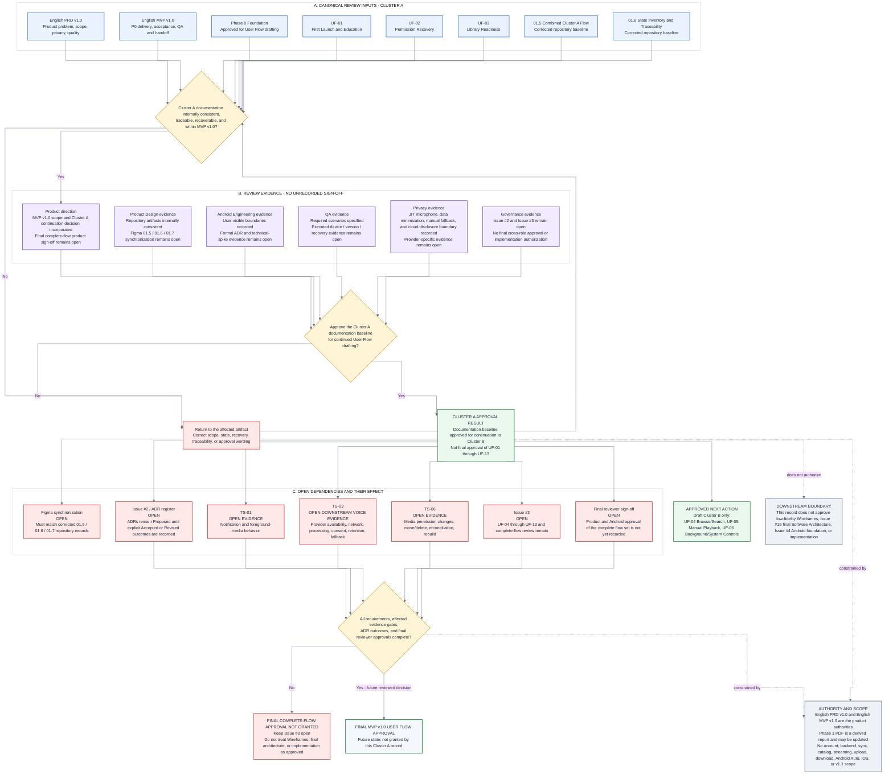

# 01.7 - Review and Approval Record

- **Product:** Music Copilot MVP v1.0
- **Phase:** User Flow Phase 1 - Cluster A First Readiness
- **Coverage:** UF-01, UF-02, UF-03, corrected `01.5` combined flow, corrected `01.6` state inventory and traceability
- **Figma source:** `01.7 / Review and Approval Record` - node `23:31`
- **Repository source:** [`01_7_REVIEW_AND_APPROVAL_RECORD.mmd`](01_7_REVIEW_AND_APPROVAL_RECORD.mmd)
- **Current decision:** Cluster A documentation baseline approved for continuation to Cluster B
- **Final-flow status:** Not approved; GitHub Issue #3 remains open
- **Tracking:** GitHub Issues #2 and #3
- **Approval meaning:** Approval in this record is limited to the Cluster A documentation baseline and the next User Flow drafting action. It is not final approval of the complete MVP v1.0 User Flow set.

## 1. Decision summary

The corrected Cluster A documentation is internally consistent enough to continue User Flow discovery:

- UF-01 - First Launch and Education.
- UF-02 - Permission Denial and Settings Recovery.
- UF-03 - Local Scan and Library Readiness.
- `01.5 / Combined Cluster A Flow`.
- `01.6 / State Inventory and Traceability`.
- This `01.7 / Review and Approval Record`.
- Scope, recovery, source-of-truth, privacy, accessibility, analytics, and open-evidence boundaries.

**Approved now:** use this Cluster A documentation baseline as the controlled input for drafting Cluster B.

**Not approved now:** the complete UF-01 through UF-13 set, final product/Android sign-off, low-fidelity Wireframes, final Software Architecture, Android foundation work, or implementation.

## 2. Authority and evidence order

1. English PRD v1.0 - product problem, scope, functional requirements, safety, privacy, and quality.
2. English MVP v1.0 - P0/P1/P2 delivery scope, user-story acceptance, QA, telemetry, ownership, and release gates.
3. Phase 0 Foundation - approved preparation for User Flow drafting, decision routing, state inventory, conflicts, and technical-spike register.
4. Current GitHub evidence - Issue #2, Issue #3, `docs/USER_FLOWS.md`, ADR register, and canonical User Flow records.
5. ADR-0001 through ADR-0006, System Architecture, and Technical Blueprint - architectural constraints and technical interpretation; they may not add product scope.
6. Figma - visual workflow evidence that must remain synchronized with the canonical repository records.

The Phase 1 First Readiness PDF is a derived report and may be revised later. It does not override the English PRD/MVP, the current GitHub issue state, or the current ADR register.

## 3. Fixed scope

- Native Android 10+.
- User-authorized local audio.
- Push-to-Talk.
- Exactly six restricted commands: PLAY, PAUSE, NEXT, PREVIOUS, SEEK_BACK, PLAY_ARTIST.
- Media access before first scan.
- Microphone access only after explicit user action.
- Manual controls remain available after Voice denial or failure.
- No account, authentication, backend, cloud sync, online catalog, streaming, upload, download, distribution, Android Auto, iOS, or v1.1 capability.
- No raw audio, full transcript, or personal media metadata in telemetry by default.
- Cloud-processed speech, if selected, requires separate consent and truthful destination, purpose, and retention disclosure.

## 4. Reviewed artifact register

| ID | Artifact | Current review result |
|---|---|---|
| `F-02 / G-UF01` | UF-01 First Launch and Education | Documentation complete for Cluster A continuation. Final complete-flow approval remains open. |
| `F-03 / G-UF02` | UF-02 Permission Recovery | Documentation complete for Cluster A continuation. TS-01, TS-03, and TS-06 remain evidence dependencies where applicable. |
| `F-04 / G-UF03` | UF-03 Library Readiness | Documentation complete for Cluster A continuation. TS-06 remains an evidence dependency. |
| `F-05 / 01.5` | Connected Cluster A flow | Corrected canonical repository flow. Figma synchronization remains required. |
| `F-06 / 01.6` | State Inventory and Traceability | Corrected canonical repository record. Figma synchronization remains required. |
| `F-07 / 01.7` | Review and Approval Record | Canonical decision record for Cluster A continuation and approval boundaries. |

## 5. Review evidence record

This record does not invent role approvals that are not stored as review evidence.

| Review area | Evidence recorded now | Still open |
|---|---|---|
| Product direction | MVP v1.0 scope, Cluster A behavior, recovery boundaries, and the Cluster B drafting decision are incorporated. | Final product approval of the complete UF-01 through UF-13 set. |
| Product Design | Repository artifacts are internally consistent and implementation-independent. | Synchronize Figma `01.5`, `01.6`, and `01.7` with the corrected repository records. |
| Android Engineering | User-visible Android boundaries and unresolved technical questions are recorded without fixing detailed implementation prematurely. | Explicit Issue #2/ADR outcomes and TS-01, TS-03, TS-06 evidence. |
| QA | Happy, denial, empty, error, revocation, retry, and manual-fallback scenarios are specified. | Executed evidence across supported Android versions, OEM devices, storage changes, and applicable Voice-provider conditions. |
| Privacy | Just-in-time microphone, data minimization, manual fallback, prohibited telemetry, and cloud-processing disclosure boundaries are recorded. | Provider-specific destination, purpose, retention, availability, network-dependence, and fallback evidence. |
| Governance | Cluster A may continue to Cluster B drafting without closing Issue #3. | Issue #2, Issue #3, final reviewer approvals, and downstream gates remain open. |

## 6. Cluster A continuation criteria

| Result | Criterion |
|---|---|
| `PASS` | UF-01, UF-02, and UF-03 are documented and linked. |
| `PASS` | Corrected connected Cluster A flow exists in `01.5`. |
| `PASS` | Corrected state inventory and traceability exist in `01.6`. |
| `PASS` | Denied and Permanently Denied are separate and recoverable. |
| `PASS` | Android Settings opens only after explicit user action and return rechecks the real condition. |
| `PASS` | Interrupted first use resumes from the pending step; Settings replay is non-mutating. |
| `PASS` | Continue and Skip record onboarding completion; Skip forces neither microphone nor notification access. |
| `PASS` | Returning users retain a verified current state and are not forced through visible Scanning. |
| `PASS` | Initial/incremental scan, Scanning, Empty, Ready, recoverable failure, and revocation reconciliation are represented. |
| `PASS` | Six-command education and just-in-time microphone behavior are explicit. |
| `PASS` | Manual controls survive microphone denial, provider unavailability, or cloud-consent decline. |
| `PASS` | P0 scope is explicit and no excluded or v1.1 capability is introduced. |
| `OPEN - SYNC` | Figma `01.5`, `01.6`, and `01.7` must match the corrected repository artifacts. |
| `OPEN - GOVERNANCE` | Issue #2 and the ADR register do not yet contain explicit final outcomes for all ADRs. |
| `OPEN - EVIDENCE` | TS-01, TS-03, and TS-06 remain unresolved evidence dependencies. |
| `OPEN - COVERAGE` | UF-04 through UF-13 remain incomplete. |
| `OPEN - APPROVAL` | Final product and Android approval of the complete flow set is not recorded. |

The open items above do not block Cluster B drafting. They do block final complete-flow approval, affected exact-behavior claims, downstream architecture approval, or implementation where applicable.

## 7. Open dependencies and effect

### Issue #2 and ADR register

Issue #2 is open and the ADR register still marks ADR-0001 through ADR-0006 as `Proposed`. Existing files and preliminary review do not make those ADRs binding. Each requires an explicit `Accepted` or `Revised` outcome with repository evidence.

**Effect:** does not invalidate the user-visible Cluster A documentation; blocks final architectural reliance and contributes to the final complete-flow approval gate.

### TS-01 - notification and foreground media

Validate notification permission, foreground-media-service visibility, denial, recovery, and Settings behavior across supported Android versions.

**Effect:** does not block Cluster B drafting; must be resolved before UF-06 and any final exact Android notification/background claim.

### TS-03 - Voice provider and cloud-processing evidence

Validate provider availability, supported language behavior, network dependence, processing destination, separate consent, retention, provider-unavailable behavior, and manual fallback.

**Effect:** Cluster A may retain the abstract just-in-time microphone and consent boundary. TS-03 is primarily a downstream Voice evidence gate and must be resolved before final Voice flows, provider-specific copy, Beta Voice approval, or final complete-flow approval.

### TS-06 - MediaStore and storage reconciliation

Validate permission changes, scoped storage behavior, moved/deleted media, incremental reconciliation, interruption recovery, and rebuild behavior.

**Effect:** does not block Cluster B drafting; must be resolved before final exact library-reconciliation behavior and implementation approval.

### Issue #3 and remaining flows

UF-04 through UF-13 and final complete-set review remain open.

**Effect:** the complete User Flow set is not approved and Issue #3 must stay open.

### Figma synchronization

The corrected repository records are canonical until the matching Figma frames are synchronized.

**Effect:** no inconsistency may be treated as approved design evidence; later work must reference the corrected repository behavior.

## 8. Approval semantics

| Term | Meaning |
|---|---|
| **Documentation baseline approved for continuation** | Cluster A is coherent enough to serve as input for the next User Flow drafting cluster. |
| **Evidence dependency open** | The abstract flow boundary may remain, but exact platform/provider behavior cannot be finalized without named evidence. |
| **Repository canonical** | The current GitHub record controls when Figma or an older derived report conflicts with it. |
| **Final complete-flow approval** | All required flows, P0 traceability, affected evidence gates, explicit ADR outcomes, and final product/Android review are complete. This status is not granted here. |

## 9. Exit decision

**Approved next action:** draft Cluster B only:

- UF-04 - Browse and Search Local Music.
- UF-05 - Manual Playback and Queue Control.
- UF-06 - Background, Screen-off, and System Controls.

This approval keeps Issue #3 open and does not authorize low-fidelity Wireframes, Issue #16 final Software Architecture, Issue #4 Android foundation work, or implementation.

## 10. Canonical approval-gate diagram

## 11. Change control

An explicit reviewed update is required before any of the following:

- marking the complete User Flow set approved;
- closing Issue #3;
- changing an ADR from Proposed without review evidence;
- removing TS-01, TS-03, or TS-06 without the required evidence;
- claiming product or Android final sign-off;
- authorizing Wireframes, final Software Architecture, Android foundation work, or implementation;
- expanding MVP v1.0 scope.
