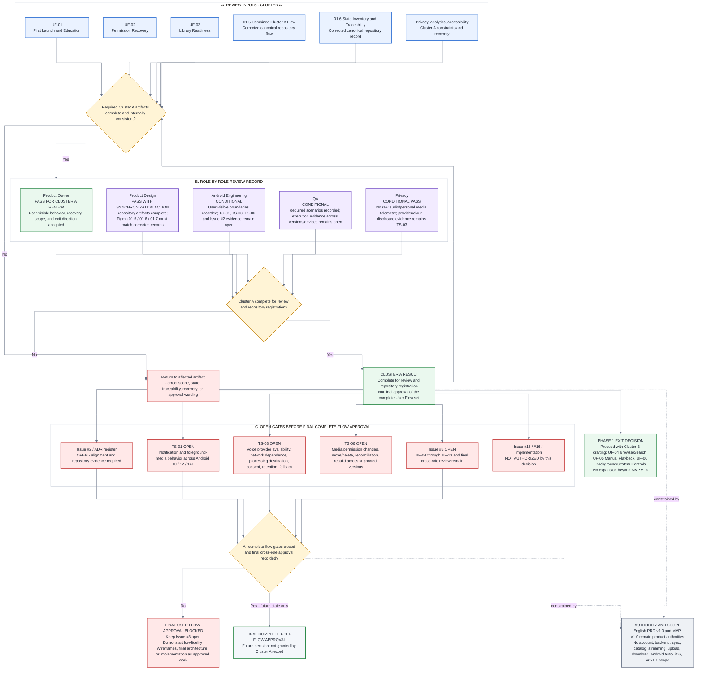

# 01.7 - Review and Approval Record

- **Product:** Music Copilot MVP v1.0
- **Phase:** User Flow Phase 1 - Cluster A First Readiness
- **Coverage:** UF-01, UF-02, UF-03, corrected `01.5` combined flow, corrected `01.6` state inventory and traceability
- **Figma source:** `01.7 / Review and Approval Record` - node `23:31`
- **Repository source:** [`01_7_REVIEW_AND_APPROVAL_RECORD.mmd`](01_7_REVIEW_AND_APPROVAL_RECORD.mmd)
- **Status:** Cluster A complete for review and repository registration; complete User Flow approval not granted
- **Tracking:** GitHub Issue #3
- **Approval boundary:** This record does not close Issue #3, approve UF-04 through UF-13, authorize low-fidelity Wireframes, approve final Software Architecture, or authorize implementation.

## 1. Decision summary

Cluster A is complete for review and repository registration because the following implementation-independent artifacts exist and are connected:

- UF-01 - First Launch and Education.
- UF-02 - Permission Denial and Settings Recovery.
- UF-03 - Local Scan and Library Readiness.
- Corrected `01.5 / Combined Cluster A Flow`.
- Corrected `01.6 / State Inventory and Traceability`.
- Privacy, analytics, accessibility, source-of-truth, recovery, and scope contracts.

This is not final approval of the complete MVP v1.0 User Flow set. GitHub Issue #2 remains open, GitHub Issue #3 remains open, UF-04 through UF-13 remain incomplete, and the named technical evidence gates remain open.

## 2. Authority and scope

Authority order for this review:

1. English PRD v1.0.
2. English MVP v1.0.
3. Phase 0 Foundation decisions and routed evidence gates.
4. Proposed ADR-0001 through ADR-0006 as constraints, not substitutes for current GitHub approval evidence.
5. System Architecture MVP v1.0 and Technical Blueprint MVP v1.0 as technical interpretation.
6. GitHub and Figma as workflow, state, traceability, and review evidence.

Fixed scope:

- Native Android 10+.
- User-authorized local audio.
- Push-to-Talk and six restricted commands.
- No account, authentication, backend, cloud sync, online catalog, streaming, upload, download, distribution, Android Auto, iOS, or v1.1 capability.
- No raw audio or personal media metadata in telemetry by default.

## 3. Reviewed artifact register

| ID | Artifact | Review result |
|---|---|---|
| `F-02 / G-UF01` | UF-01 First Launch and Education | Complete for Cluster A review. |
| `F-03 / G-UF02` | UF-02 Permission Recovery | Complete for Cluster A review; TS-01, TS-03, and TS-06 remain evidence gates where applicable. |
| `F-04 / G-UF03` | UF-03 Library Readiness | Complete for Cluster A review; TS-06 remains open. |
| `F-05 / 01.5` | Connected Cluster A flow | Corrected canonical repository flow; Figma must match the corrected resume, replay, permission recheck, returning-user, and cloud-consent branches. |
| `F-06 / 01.6` | State Inventory and Traceability | Corrected canonical repository record; Figma must include CA-01, CA-02, SYS-05, D-005, D-016, D-028, D-030, and TS-03. |
| `F-07 / 01.7` | Review and Approval Record | This file is the canonical repository review record and approval-gate diagram. |

## 4. Role-by-role review record

| Role | Current result | Accepted now | Still open |
|---|---|---|---|
| Product Owner | **Pass for Cluster A review** | MVP v1.0 scope, user-visible behavior, recovery paths, state ownership, and Cluster B exit direction. | Final approval of the complete UF-01 through UF-13 set. |
| Product Design | **Pass with synchronization action** | Cluster A coverage, terminal states, recovery behavior, and implementation-independent representation. | Synchronize Figma `01.5`, `01.6`, and `01.7` with the corrected canonical repository artifacts. |
| Android Engineering | **Conditional** | User-visible Android boundaries are recorded without inventing final implementation. | Issue #2 evidence and ADR-register alignment; TS-01, TS-03, and TS-06 validation. |
| QA | **Conditional** | Required happy, denial, empty, error, revocation, retry, and fallback scenarios are recorded. | Executed evidence across Android versions, OEM devices, and applicable provider/storage conditions. |
| Privacy | **Conditional pass** | Just-in-time microphone, no raw-audio default, no personal-media telemetry, manual fallback, and separate cloud-speech disclosure boundary. | TS-03 provider destination, purpose, retention, availability, network dependence, and fallback evidence. |
| Governance | **Open** | Cluster A may proceed to the next drafting cluster. | Issue #2 remains open; Issue #3 remains open; final cross-role approval is not recorded. |

## 5. Cluster A Definition of Done

| Result | Criterion |
|---|---|
| `PASS` | UF-01, UF-02, and UF-03 exist in Figma and GitHub. |
| `PASS` | Corrected connected Cluster A flow exists in `01.5`. |
| `PASS` | Denied and Permanently Denied are separate. |
| `PASS` | Android Settings opens only after explicit user action and return always rechecks the real condition. |
| `PASS` | Incomplete first use resumes from the pending step; Settings replay is non-mutating. |
| `PASS` | Continue and Skip record onboarding completion; Skip never forces microphone or notification access. |
| `PASS` | Returning users do not enter visible Scanning when a verified current state already exists. |
| `PASS` | Initial/incremental scan, Scanning, Empty, Ready, recoverable failure, and revoked/reconciled states are present. |
| `PASS` | Six-command education and just-in-time microphone behavior are explicit. |
| `PASS` | Manual controls remain after microphone denial, provider unavailability, or cloud-consent decline. |
| `PASS` | Corrected state inventory, traceability, privacy, accessibility, and source-of-truth records exist in `01.6`. |
| `PASS` | P0 scope is explicit and no v1.1 or excluded capability is introduced. |
| `SYNC` | Figma `01.5`, `01.6`, and `01.7` must be synchronized with their corrected repository records. |
| `OPEN` | TS-01 evidence. |
| `OPEN` | TS-03 evidence. |
| `OPEN` | TS-06 evidence. |
| `OPEN` | UF-04 through UF-13. |
| `OPEN` | Issue #2 / ADR register alignment and final complete-flow approval. |

## 6. Open gates

### Issue #2 and ADR register

GitHub Issue #2 is open. The ADR review has partial checked criteria, but repository evidence, explicit open assumptions, final register alignment, and closure criteria remain incomplete. Cluster A may remain complete for review, but complete User Flow approval remains blocked until Issue #2 and the ADR register agree.

### TS-01

Validate notification permission, foreground-media-service visibility, denial, recovery, and Settings behavior across Android 10, Android 12, and Android 14+.

### TS-03

Validate voice-provider availability, supported language behavior, network dependence, processing destination, separate consent, retention disclosure, provider-unavailable behavior, and manual fallback.

### TS-06

Validate MediaStore and scoped-storage permission changes, moved/deleted media, incremental reconciliation, interruption recovery, and rebuild behavior across supported Android versions.

### Remaining User Flows

GitHub Issue #3 is open. UF-04 through UF-13 and final cross-role review remain required before the complete User Flow set can be approved.

### Downstream gates

Low-fidelity Wireframes, final Software Architecture, Android foundation work, and implementation are not authorized by this record.

## 7. Approval semantics

| Term | Meaning in this project |
|---|---|
| **Pass for Cluster A review** | The reviewed Cluster A user-visible behavior and documentation are sufficient to continue User Flow drafting. |
| **Conditional** | The flow boundary is usable for drafting, but named technical or executed evidence remains open. |
| **Complete for repository registration** | Durable canonical records exist in GitHub and can be referenced by later work. |
| **Final complete-flow approval** | UF-01 through UF-13, cross-role approval, Issue #2/ADR alignment, and all required evidence gates are complete. This status is not granted here. |

## 8. Exit decision

**Approved next action:** proceed to Cluster B drafting:

- UF-04 - Browse and Search Local Music.
- UF-05 - Manual Playback and Queue Control.
- UF-06 - Background, Screen-off, and System Controls.

This exit decision preserves Issue #3 as open and does not authorize Wireframes, final architecture, or implementation.

## 9. Canonical approval-gate diagram

## 10. Change control

Any change that marks final User Flow approval, closes Issue #3, removes TS-01/TS-03/TS-06 without evidence, authorizes Wireframes/final architecture/implementation, or expands MVP v1.0 scope requires an explicit reviewed update to this record and the relevant GitHub issues/registers.
