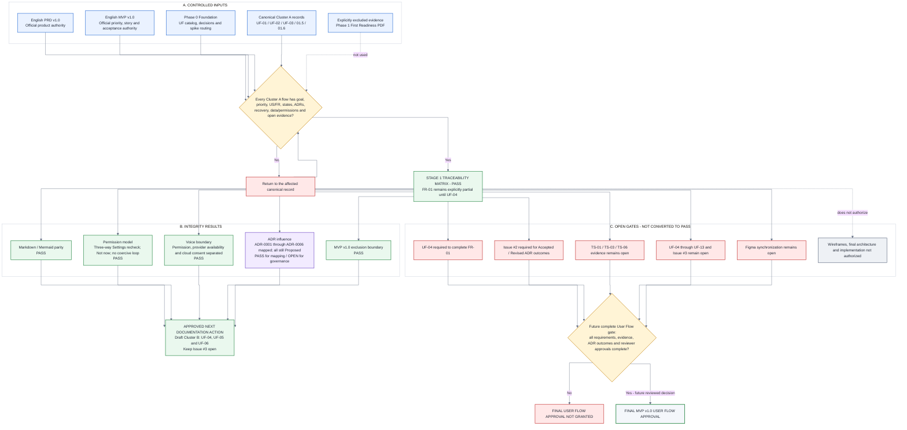

# 01.7 - Review and Approval Record

- **Product:** Music Copilot MVP v1.0
- **Review scope:** Stage 1 Traceability Matrix for Cluster A (UF-01, UF-02, UF-03)
- **Canonical diagram source:** [01_7_REVIEW_AND_APPROVAL_RECORD.mmd](01_7_REVIEW_AND_APPROVAL_RECORD.mmd)
- **Decision:** Stage 1 Traceability Matrix gate PASSED
- **Final User Flow status:** Not approved; Issue #3 remains open
- **Approval meaning:** This decision approves the corrected Cluster A documentation as input to the next User Flow drafting cluster. It does not approve the complete UF-01 through UF-13 set or any downstream implementation activity.

## 1. Controlled authority

1. Music_Copilot_PRD_v1_EN_Clarified.pdf is the official product authority.
2. Music_Copilot_MVP_v1_EN.pdf is the official priority, User Story, state, acceptance, QA, and release authority.
3. Music_Copilot_User_Flow_Phase_0_Foundation_v1.0_EN.pdf supplies the approved UF catalog, fixed drafting decisions, and open evidence routing.
4. ADR-0001 through ADR-0006, System Architecture, and Technical Documentation constrain technical interpretation but may not expand or override the PRD/MVP.
5. Repository records are canonical for the current User Flow documentation state until Figma is synchronized.

**Excluded evidence:** Music_Copilot_User_Flow_Phase_1_First_Readiness_v1.0_EN.pdf was intentionally not read or used for these corrections or this decision.

## 2. Reviewed artifact register

| Artifact | Review result |
|---|---|
| UF-01 First Launch and Education | P0 goal, US-01/US-02, partial FR-01 contribution, required states, all relevant ADR influence, recovery, data/permission boundaries, and open evidence are traceable. |
| UF-02 Permission Denial and Settings Recovery | Media and microphone Settings return have three explicit outcomes; Not now is available; provider unavailability is distinct from permission denial; manual fallback remains. |
| UF-03 Library Readiness | Initial/incremental scan, truthful Scanning/Empty/Ready, recoverable failure, revocation reconciliation, MediaStore authority, and rebuildable-index boundaries are traceable. |
| 01.5 Combined Cluster A Flow | Canonical combined logic is synchronized with its raw Mermaid source. |
| 01.6 State Inventory and Traceability | Contains the required per-flow matrix and explicit Partial/Open statuses; canonical diagram is synchronized. |
| 01.7 Review and Approval Record | Records this limited gate decision without inventing final product, Android, QA, Privacy, or Governance signatures. |

## 3. Stage 1 gate evidence

| Gate criterion | Result | Evidence |
|---|---|---|
| Flow ID and user goal per Cluster A flow | PASS | One row each for UF-01, UF-02, UF-03 in 01.6 section 4. |
| P0 priority per flow | PASS | Explicit in every row. |
| User Story mapping | PASS | UF-01: US-01/US-02; UF-02: US-01; UF-03: US-02. |
| Functional Requirement mapping | PASS | FR-01 is correctly recorded as partial; UF-04 is required for complete Songs/Artists/Albums/Folders behavior. |
| Screen/state mapping | PASS | S-01 through S-04, CA-01/CA-02, SYS-01 through SYS-05 as applicable. |
| ADR influence | PASS for traceability | ADR-0001 through ADR-0006 are mapped; none is falsely marked Accepted. |
| Failure and recovery | PASS | Startup, denial, permanent denial, three-way Settings return, provider unavailable, cloud-consent decline, scan failure, and revocation recovery are explicit. |
| Data and permission boundaries | PASS | Android permission state, MediaStore, derived index, playback service, local flags/consent, and telemetry boundaries are explicit. |
| Open assumptions/evidence | PASS | TS-01, TS-03, TS-06, Issue #2, UF-04, and Figma synchronization are recorded with effects. |
| Markdown/Mermaid parity | PASS | Each .mmd is generated from the Mermaid block in its paired .md and validated. |
| Source exclusion | PASS | Phase 1 First Readiness PDF is not evidence. |
| Scope control | PASS | No account, backend, sync, catalog, streaming, upload, download, Android Auto, iOS, or v1.1 capability is introduced. |

## 4. Correct interpretation of the pass

The pass means that the **matrix is complete, explicit, internally consistent, and suitable for continuing User Flow drafting**.

It does not mean:

- FR-01 is complete - UF-04 must finish browsing/search by Songs, Artists, Albums, and Folders.
- ADR-0001 through ADR-0006 are accepted - every ADR source is still Proposed until Issue #2 records an Accepted or Revised outcome.
- TS-01, TS-03, or TS-06 has executed evidence.
- Figma already matches the corrected repository records.
- UF-04 through UF-13 are complete.
- Issue #3 can close.
- low-fidelity Wireframes, final Software Architecture, Android foundation work, or implementation is approved.

## 5. Open dependencies and effect

| Dependency | Current state | Effect |
|---|---|---|
| UF-04 Browse and Search | Open | Required to complete FR-01; approved as the first Cluster B drafting task. |
| Issue #2 / ADR register | Open | Blocks treating the six proposed ADRs as approved architecture. |
| TS-01 | Open | Blocks final exact notification/foreground-media behavior in UF-06. |
| TS-03 | Open | Blocks provider-specific Voice copy, cloud-processing claims, and final Voice approval. |
| TS-06 | Open | Blocks final exact storage/reconciliation implementation claims. |
| Figma 01.5/01.6/01.7 sync | Open | An older visual snapshot cannot be used as canonical approval evidence. |
| UF-04 through UF-13 / Issue #3 | Open | Blocks final complete User Flow approval and downstream gates. |
| Final reviewer sign-off | Not recorded | No role approval is inferred from document completeness. |

These items do not invalidate the Stage 1 matrix pass because the matrix records them explicitly. They remain blockers only for the affected later claims and gates.

## 6. Approved next action

Proceed with **Cluster B drafting only**:

- UF-04 - Browse and Search Local Music.
- UF-05 - Manual Playback and Queue Control.
- UF-06 - Background, Screen-off, and System Controls.

Issue #3 remains open. The Stage 1 pass does not authorize Wireframes, final architecture, foundation implementation, or production code.

## 7. Change control

A reviewed update is required before any of the following:

- marking FR-01 complete;
- changing an ADR from Proposed to Accepted or Revised;
- removing TS-01, TS-03, or TS-06 without evidence;
- claiming Figma parity before synchronization;
- claiming final Product, Android, QA, Privacy, or Governance approval;
- closing Issue #3;
- starting downstream work as approved;
- expanding MVP v1.0 scope.

## 8. Canonical approval diagram

