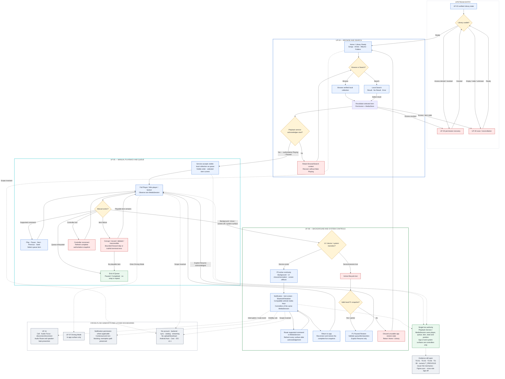

# Cluster B — Connected Flow Diagram

**Scope:** UF-04 → UF-05 → UF-06  
**Product:** Music Copilot MVP v1.0  
**Reviewed:** 06 August 2026  
**Connected-flow review:** **PASS**  
**Cluster B formal exit:** **OPEN** — Figma synchronization, executed Technical Spikes, and cross-role sign-off remain outstanding  
**Controlled review record:** [`../CLUSTER_B_CONNECTED_REVIEW.md`](../CLUSTER_B_CONNECTED_REVIEW.md)  
**Raw source:** [`CLUSTER_B_CONNECTED_FLOW.mmd`](CLUSTER_B_CONNECTED_FLOW.mmd)

This diagram is the canonical connected behavior map for Cluster B. It connects the approved specification-level contracts of UF-04, UF-05, and UF-06 without replacing their detailed state inventories.

## Reading rule

- Solid arrows are user/system transitions inside the connected Cluster B contract.
- Dotted arrows are governed handoffs, scope boundaries, or unresolved evidence—not alternate happy paths.
- Detailed substates and exception rules remain normative in the three individual UF documents.
- A system surface never owns playback; it issues commands to and observes the same service-owned MediaSession.

## Review boundary

The diagram passes connected-flow review because it has no missing handoff between UF-04, UF-05, and UF-06 and preserves every locked cross-flow invariant. This PASS does not assert Figma parity, device/OEM evidence, implementation readiness, Product/Design/Android/QA/Privacy approval, or final Cluster B exit.
