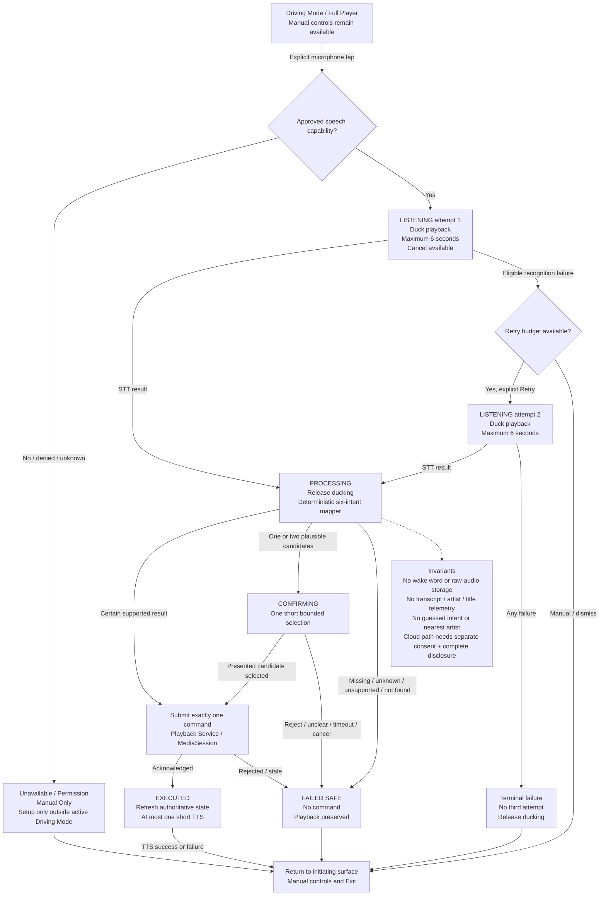

# Cluster D - Connected Voice Flow

The Markdown graph and raw `.mmd` file are canonical logical peers. Exact visual design, animations, copy, and component ownership remain downstream Wireframe/architecture work.
