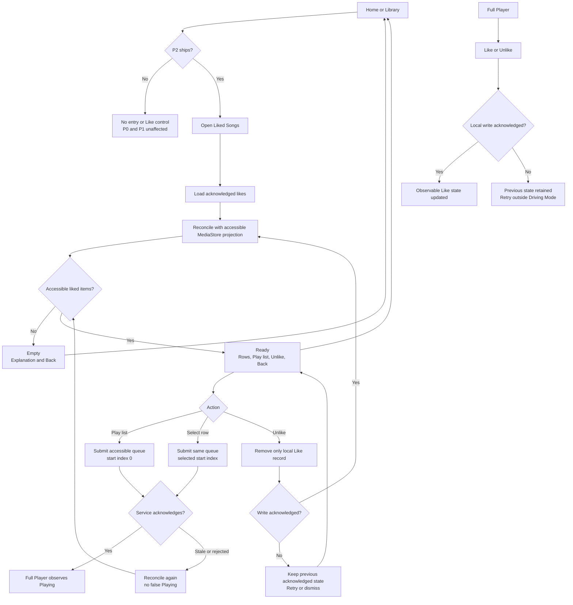

# UF-13 - Canonical Mermaid Diagram

This rendering is canonical with [`UF-13_LIKED_SONGS.mmd`](UF-13_LIKED_SONGS.mmd). It shows the P2 schedule gate, Empty/Ready states, local mutation acknowledgement, MediaStore reconciliation, and service-owned playback handoff.

The diagram does not imply a database schema, UI styling, or automatic navigation from Full Player.
